# CausalAds

**Which customers should receive a marketing campaign, and what incremental effect does the campaign actually cause?**

CausalAds is an end-to-end statistical ML and causal-inference pipeline on a real randomized email campaign
(Kevin Hillstrom's MineThatData E-Mail Analytics challenge: 64,000 customers, randomized to a Mens email,
a Womens email, or no email). There are no LLMs in it: SQL, pandas, scikit-learn, XGBoost/LightGBM,
statsmodels, and EconML.

| Layer | Question | Methods |
|---|---|---|
| Experiment readout | Did the emails work, and by how much? | Randomization checks, two-proportion / Welch / Mann-Whitney tests, bootstrap and delta-method CIs, Holm correction, regression adjustment (CUPED-style), power/MDE, iROAS |
| Prediction | Who is likely to convert? | Logistic regression, Random Forest, XGBoost, LightGBM; Optuna tuning, repeated stratified CV, class-imbalance handling, Platt/isotonic calibration, SHAP, error analysis |
| Propensity scores | Could we recover the effect without an experiment? | Semi-synthetic confounded samples from the RCT; logistic/GBM propensity models, matching, stratification, IPW, doubly robust (AIPW); bias/RMSE/coverage against the RCT truth |
| Uplift / HTE | Who responds *because* of the email? | S/T/X/DR-learners, causal forests (EconML), Qini/AUUC, GATES + BLP heterogeneity test, interpretable segment rules, KMeans segments |
| Budget optimization | Where should a fixed budget go? | Off-policy (IPW) evaluation of targeting policies on held-out randomized data; uplift vs response-model targeting |
| Difference-in-differences | Did a geo campaign lift conversions? | 2x2 DiD, TWFE, event study / pre-trend test, permutation inference, synthetic control, power simulation |

```
raw CSV (64,000 customers)
  -> DuckDB SQL: typing, cleaning, feature engineering        sql/01_clean.sql, sql/02_features.sql
  -> validation + fixed stratified train/val/test split       src/causalads/data.py
  -> experiment readout (hypothesis tests, CIs, iROAS)        src/causalads/experiment.py
  -> response models (LR / RF / XGBoost / LightGBM)           src/causalads/prediction.py
  -> propensity-score estimators vs RCT ground truth          src/causalads/observational.py
  -> uplift / causal forest / segments / budget optimizer     src/causalads/uplift.py
  -> geo-level difference-in-differences                      src/causalads/did.py
  -> this README                                              src/causalads/report.py
```

## Reproduce

```bash
uv sync
uv run causalads all          # every stage, then regenerates this README
uv run causalads uplift       # or a single stage
```

Raw data is downloaded on first run. Every number below is generated from `results/*.json` by
`src/causalads/report.py`; nothing is typed by hand.

## Key results

| Question | Result (95% CI) |
|---|---|
| Did the Mens email work? | Visits **+7.7 pp** [7.0, 8.3], conversions **+0.68 pp** [0.50, 0.86] (+119% relative), **$770** incremental sales per 1,000 emails [484, 1052] (gross customer spend, not margin) |
| Can we predict who converts? | Test ROC-AUC 0.64-0.66 across LR / RF / XGBoost / LightGBM. Gradient boosting's gain over logistic regression is not significant (ΔAUC +0.001, p = 0.93). |
| Can propensity scores replace the experiment? | On confounded samples, the naive estimate is biased **+61%**. Doubly robust AIPW recovers the RCT effect with no detectable bias: the lowest-RMSE variant, AIPW (GBM PS + GLM outcome), has -0.4% bias [-1.3, 0.5]% and 97% CI coverage over 300 replicates. The confounding comes from a simulated targeting rule. |
| Is there real heterogeneity? | Yes, for visits: BLP test beta2 = 0.62, one-sided p = 0.006. Segment "bought women's AND past-year spend > $364" (rule learned on validation, scored on test): **+10.6 pp** [6.8, 14.4] vs +5.5 pp for all other customers (difference +5.1 pp [1.1, 9.1], p = 0.01) |
| Where should a 30% budget go? | Emailing the top 30% by response-model score captures **41%** [30, 52] of the incremental visits of sending the Mens email to everyone. Multi-arm uplift targeting does **not** beat it (-8.4 visits / 1k [-18.3, 0.7]). |
| Did the geo campaign lift conversions? | DiD **+7.2%** [-6.5, 25.5], permutation p = 0.35. The point estimate is consistent with GeoLift's published 5.4% (p = 0.01, augmented synthetic control). Under cross-city permutation inference, though, the minimum detectable lift is 10.2% at 80% power, so a 5-7% effect cannot be confirmed. |

## Data

Source: MineThatData E-Mail Analytics challenge (Hillstrom, 2008). 64,000 customers who purchased in the last
12 months were randomly split into three equal groups; outcomes are measured over the following two weeks.

| Arm | Customers | Visit rate | Conversion rate | Spend / customer |
|---|---|---|---|---|
| Mens E-Mail | 21,307 | 18.28% | 1.25% | $1.423 |
| No E-Mail | 21,306 | 10.62% | 0.57% | $0.653 |
| Womens E-Mail | 21,387 | 15.14% | 0.88% | $1.077 |

Data-quality findings from `data.validate_raw` and the SQL cleaning step:
- 0 missing values. The pipeline still imputes (median / mode plus missing-indicator columns), so it does not rely on that.
- `zip_code` spells *Suburban* as "Surburban" in 28,776 rows. This is fixed in SQL; without the fix the one-hot `zip_suburban` feature is silently all zeros.
- `history` is floor-censored at $29.99 for 7,947 customers (12.4%). This is kept as a `history_at_floor` flag. These customers explain the 6,562 exact-duplicate rows, which are distinct customers and are kept.
- Fixed split, stratified on arm x visit x conversion: train 38,400 / validation 12,800 / test 12,800.

## Experiment readout: randomized email test (Hillstrom, n=64,000)

Each customer was randomized 1/3 each to No E-Mail (21,306), Mens E-Mail (21,307) or Womens E-Mail (21,387); outcomes are site visit, purchase and spend over the following two weeks. The full 64,000-row sample is used (this is a readout, not model training). Aggregates come from DuckDB SQL (`sql/experiment_*.sql`); inference is in Python. Binary outcomes: unpooled Wald difference CI, pooled two-proportion z p-value, and delta-method CI for the relative lift (log ratio). Spend is heavy-tailed, so the primary test is Welch t with a 2,000-draw percentile bootstrap CI (Mann-Whitney shown as a robustness check). The 12 primary tests (4 comparisons x 3 outcomes) are Holm-adjusted together.

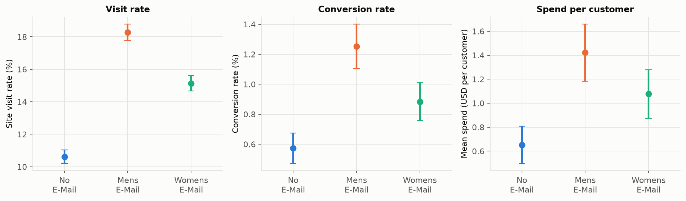

### EDA

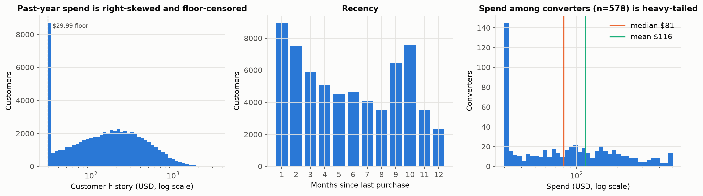

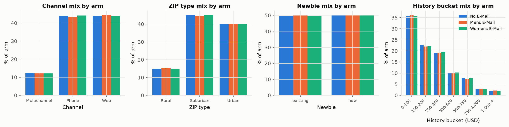

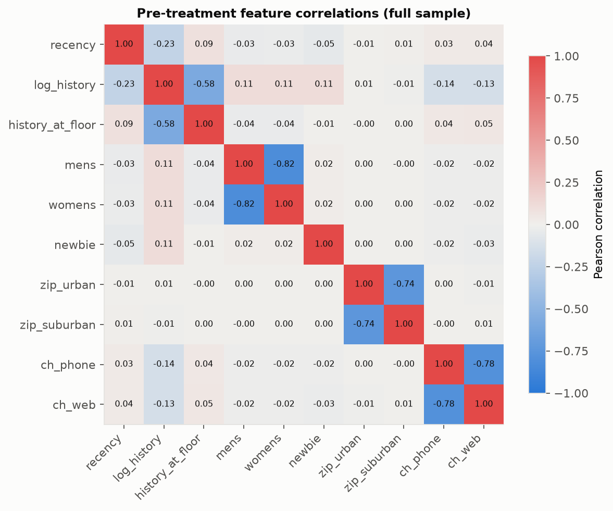

### Randomization check

| Variable | Test | Statistic | df | p (raw) | p (Holm) |
|---|---|---|---|---|---|
| channel | chi-square | 3.63 | 4 | 0.458 | 1.000 |
| zip_code | chi-square | 2.87 | 4 | 0.579 | 1.000 |
| newbie | chi-square | 0.14 | 2 | 0.934 | 1.000 |
| past mens buyer | chi-square | 0.80 | 2 | 0.672 | 1.000 |
| past womens buyer | chi-square | 0.63 | 2 | 0.729 | 1.000 |
| history bucket | chi-square | 13.15 | 12 | 0.358 | 1.000 |
| recency | Kruskal-Wallis | 0.46 | 2 | 0.794 | 1.000 |
| history | Kruskal-Wallis | 0.81 | 2 | 0.667 | 1.000 |

Omnibus LR test that the 10 covariates jointly predict arm (multinomial logit): chi2(20) = 15.1, p = 0.768. Max |SMD| vs control: 0.014 (Mens/Womens).

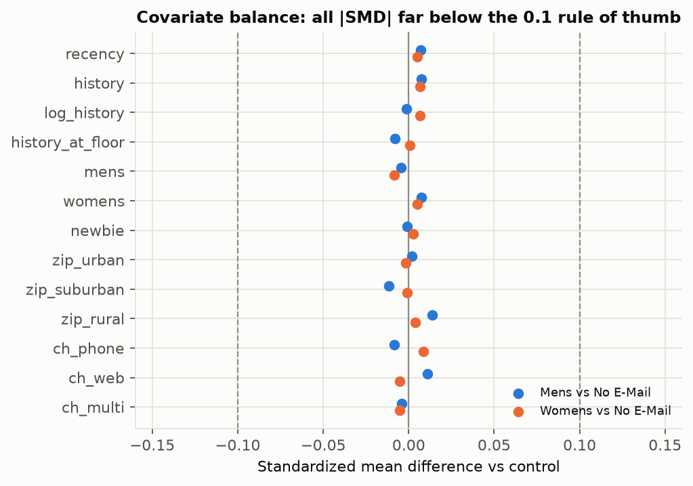

### Average treatment effects

**Site visit** (difference in pp; 95% CI)

| Comparison | Control mean (%) | Treated mean (%) | ATE (pp) [95% CI] | Relative lift % [95% CI] | p (raw) | p (Holm, 12 tests) |
|---|---|---|---|---|---|---|
| Mens vs No E-Mail | 10.62 | 18.28 | 7.66 [7.00, 8.32] | 72.1% [64.0, 80.6] | <0.0001 | <0.0001 |
| Womens vs No E-Mail | 10.62 | 15.14 | 4.52 [3.89, 5.16] | 42.6% [35.6, 50.0] | <0.0001 | <0.0001 |
| Any E-Mail vs No E-Mail | 10.62 | 16.70 | 6.09 [5.54, 6.63] | 57.3% [50.5, 64.5] | <0.0001 | <0.0001 |
| Mens vs Womens | 15.14 | 18.28 | 3.14 [2.43, 3.84] | 20.7% [15.7, 26.0] | <0.0001 | <0.0001 |

**Conversion** (difference in pp; 95% CI)

| Comparison | Control mean (%) | Treated mean (%) | ATE (pp) [95% CI] | Relative lift % [95% CI] | p (raw) | p (Holm, 12 tests) |
|---|---|---|---|---|---|---|
| Mens vs No E-Mail | 0.57 | 1.25 | 0.68 [0.50, 0.86] | 118.8% [76.8, 170.9] | <0.0001 | <0.0001 |
| Womens vs No E-Mail | 0.57 | 0.88 | 0.31 [0.15, 0.47] | 54.3% [23.0, 93.6] | 0.0002 | 0.0006 |
| Any E-Mail vs No E-Mail | 0.57 | 1.07 | 0.50 [0.35, 0.64] | 86.5% [52.9, 127.6] | <0.0001 | <0.0001 |
| Mens vs Womens | 0.88 | 1.25 | 0.37 [0.17, 0.56] | 41.8% [17.8, 70.7] | 0.0002 | 0.0006 |

**Spend** (difference in USD; 95% CI = bootstrap)

| Comparison | Control mean (USD) | Treated mean (USD) | ATE (USD) [95% CI] | Relative lift % [95% CI] | p (raw) | p (Holm, 12 tests) | Mann-Whitney p |
|---|---|---|---|---|---|---|---|
| Mens vs No E-Mail | 0.653 | 1.423 | 0.770 [0.484, 1.052] | 117.9% [63.9, 196.1] | <0.0001 | <0.0001 | <0.0001 |
| Womens vs No E-Mail | 0.653 | 1.077 | 0.424 [0.171, 0.685] | 65.0% [22.8, 125.8] | 0.0011 | 0.0023 | 0.0002 |
| Any E-Mail vs No E-Mail | 0.653 | 1.250 | 0.597 [0.375, 0.822] | 91.4% [47.7, 154.9] | <0.0001 | <0.0001 | <0.0001 |
| Mens vs Womens | 1.077 | 1.423 | 0.345 [0.028, 0.653] | 32.1% [2.3, 68.7] | 0.030 | 0.030 | 0.0002 |

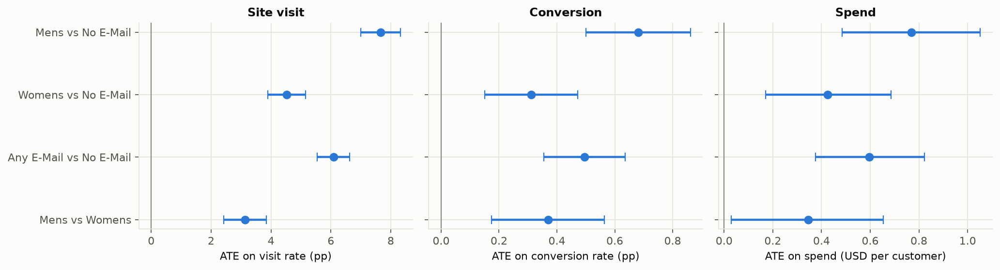

### Variance reduction (Lin 2013 regression adjustment)

OLS of the outcome on treatment, the 10 centred pre-treatment covariates and their interactions with treatment; HC2 robust SEs. The comparison is against the unadjusted HC2 SE (same estimator, no covariates). Reductions are small because the covariates predict a rare, mostly-idiosyncratic outcome poorly; in an RCT this only affects precision, not validity.

| Comparison | Outcome | Unadj. ATE | Adj. ATE | Unadj. SE | Adj. SE | SE reduction |
|---|---|---|---|---|---|---|
| Mens vs No E-Mail | visit | 7.659 | 7.622 | 0.3386 | 0.3336 | 1.5% |
| Mens vs No E-Mail | conversion | 0.681 | 0.680 | 0.0921 | 0.0920 | 0.1% |
| Mens vs No E-Mail | spend | 0.770 | 0.770 | 0.1452 | 0.1450 | 0.2% |
| Womens vs No E-Mail | visit | 4.523 | 4.540 | 0.3234 | 0.3189 | 1.4% |
| Womens vs No E-Mail | conversion | 0.311 | 0.312 | 0.0823 | 0.0822 | 0.1% |
| Womens vs No E-Mail | spend | 0.424 | 0.426 | 0.1303 | 0.1304 | -0.1% |
| Any E-Mail vs No E-Mail | visit | 6.088 | 6.083 | 0.2777 | 0.2738 | 1.4% |
| Any E-Mail vs No E-Mail | conversion | 0.495 | 0.496 | 0.0717 | 0.0717 | 0.1% |
| Any E-Mail vs No E-Mail | spend | 0.597 | 0.598 | 0.1126 | 0.1124 | 0.1% |
| Mens vs Womens | visit | 3.136 | 3.064 | 0.3608 | 0.3557 | 1.4% |
| Mens vs Womens | conversion | 0.369 | 0.366 | 0.0995 | 0.0995 | 0.0% |
| Mens vs Womens | spend | 0.345 | 0.342 | 0.1596 | 0.1593 | 0.2% |
(Rates in pp, spend in USD.)

### Power

Two-sided alpha = 0.05, 80% power, arm sizes as run. MDE = smallest true effect detectable; required n is per arm, to detect the observed effect.

| Comparison | Outcome | Baseline | MDE (abs) | MDE (rel) | Observed | n/arm to detect observed |
|---|---|---|---|---|---|---|
| Mens vs No E-Mail | visit | 10.62 | 0.85 pp | 8.0% | 7.66 pp | 327 |
| Mens vs No E-Mail | conversion | 0.57 | 0.22 pp | 39.1% | 0.68 pp | 3,062 |
| Mens vs No E-Mail | spend | 0.653 | 0.407 USD | 62.3% | 0.770 USD | - |
| Womens vs No E-Mail | visit | 10.62 | 0.85 pp | 8.0% | 4.52 pp | 857 |
| Womens vs No E-Mail | conversion | 0.57 | 0.22 pp | 39.0% | 0.31 pp | 11,720 |
| Womens vs No E-Mail | spend | 0.653 | 0.365 USD | 55.9% | 0.424 USD | - |
| Any E-Mail vs No E-Mail | visit | 10.62 | 0.73 pp | 6.9% | 6.09 pp | 496 |
| Any E-Mail vs No E-Mail | conversion | 0.57 | 0.19 pp | 32.6% | 0.50 pp | 5,199 |
| Any E-Mail vs No E-Mail | spend | 0.653 | 0.315 USD | 48.3% | 0.597 USD | - |
| Mens vs Womens | visit | 15.14 | 0.98 pp | 6.5% | 3.14 pp | 2,218 |
| Mens vs Womens | conversion | 0.88 | 0.27 pp | 30.8% | 0.37 pp | 12,156 |
| Mens vs Womens | spend | 1.077 | 0.447 USD | 41.5% | 0.345 USD | - |

### Incrementality

**Cost assumption:** `COST_PER_CONTACT = $0.10` per email is an ILLUSTRATIVE assumption (the dataset has no cost column). The break-even cost per email (= incremental revenue per email) does not depend on it. Revenue is the two-week spend only (no margin, no lifetime value). Totals scale each ATE to the number of emails actually sent in that arm of the test.

| Arm | Emails sent | Incr. visits /1k [95% CI] | Incr. conversions /1k [95% CI] | Incr. revenue /1k (USD) [95% CI] | Total incr. revenue (USD) | iROAS @ $0.10/email | Break-even cost / email (USD) |
|---|---|---|---|---|---|---|---|
| Mens | 21,307 | 76.6 [70.0, 83.2] | 6.8 [5.0, 8.6] | 770 [484, 1052] | 16403 [10313, 22409] | 7.70 [4.85, 10.55] | 0.770 [0.485, 1.055] |
| Womens | 21,387 | 45.2 [38.9, 51.6] | 3.1 [1.5, 4.7] | 424 [171, 685] | 9077 [3662, 14659] | 4.24 [1.69, 6.80] | 0.424 [0.169, 0.680] |
| Any E-Mail | 42,694 | 60.9 [55.4, 66.3] | 5.0 [3.5, 6.4] | 597 [375, 822] | 25480 [16020, 35091] | 5.97 [3.76, 8.17] | 0.597 [0.376, 0.817] |

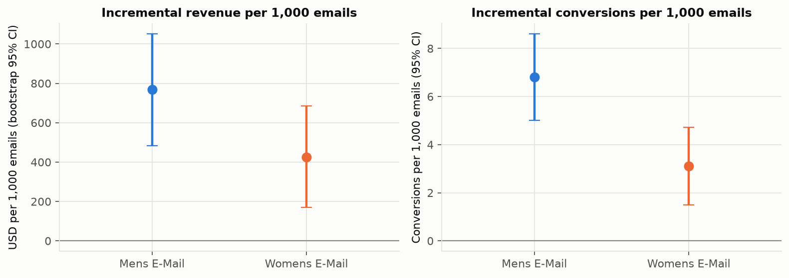

### Segment readout and heterogeneity

Pre-specified segments (channel, ZIP type, newbie, past mens / womens buyer, history bucket), defined before looking at outcomes. Per-segment ATEs vs No E-Mail with 95% Wald CIs; Holm correction over all 76 segment x arm x outcome tests. Interaction tests are linear-probability models `y ~ T x segment` with HC2 SEs (joint Wald test on the interaction terms), Holm-adjusted over all 24 interaction tests.

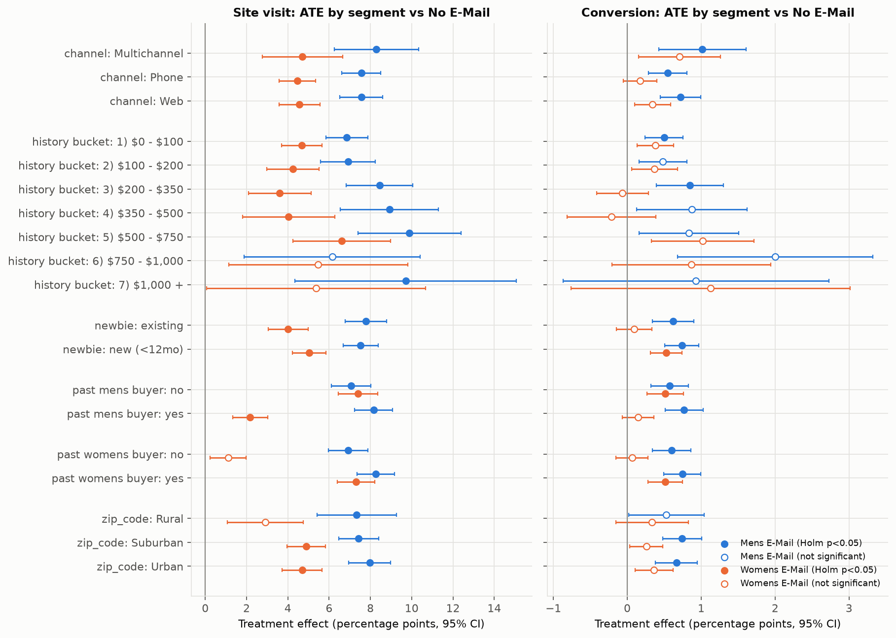

| Segment | Level | n control | Mens: visit pp (Holm p) | Mens: conv. pp (Holm p) | Womens: visit pp (Holm p) | Womens: conv. pp (Holm p) |
|---|---|---|---|---|---|---|
| channel | Multichannel | 2,606 | 8.29 [6.26, 10.33] (<0.0001) | 1.02 [0.42, 1.61] (0.021) | 4.71 [2.76, 6.66] (<0.0001) | 0.71 [0.15, 1.26] (0.233) |
| channel | Phone | 9,327 | 7.56 [6.61, 8.51] (<0.0001) | 0.55 [0.29, 0.80] (0.0011) | 4.46 [3.57, 5.35] (<0.0001) | 0.17 [-0.05, 0.40] (1.000) |
| channel | Web | 9,373 | 7.56 [6.53, 8.59] (<0.0001) | 0.72 [0.45, 0.99] (<0.0001) | 4.57 [3.57, 5.56] (<0.0001) | 0.34 [0.10, 0.59] (0.128) |
| history bucket | 1) $0 - $100 | 7,612 | 6.86 [5.84, 7.87] (<0.0001) | 0.50 [0.24, 0.76] (0.0050) | 4.68 [3.69, 5.66] (<0.0001) | 0.38 [0.13, 0.63] (0.070) |
| history bucket | 2) $100 - $200 | 4,836 | 6.91 [5.59, 8.24] (<0.0001) | 0.48 [0.16, 0.81] (0.085) | 4.25 [2.99, 5.51] (<0.0001) | 0.37 [0.06, 0.68] (0.285) |
| history bucket | 3) $200 - $350 | 4,044 | 8.44 [6.82, 10.06] (<0.0001) | 0.85 [0.39, 1.30] (0.0086) | 3.61 [2.09, 5.13] (0.0001) | -0.07 [-0.42, 0.28] (1.000) |
| history bucket | 4) $350 - $500 | 2,124 | 8.92 [6.54, 11.30] (<0.0001) | 0.87 [0.12, 1.62] (0.312) | 4.04 [1.80, 6.28] (0.013) | -0.22 [-0.82, 0.39] (1.000) |
| history bucket | 5) $500 - $750 | 1,652 | 9.90 [7.40, 12.39] (<0.0001) | 0.83 [0.16, 1.51] (0.234) | 6.61 [4.24, 8.98] (<0.0001) | 1.02 [0.33, 1.71] (0.094) |
| history bucket | 6) $750 - $1,000 | 622 | 6.15 [1.89, 10.41] (0.108) | 2.00 [0.68, 3.32] (0.085) | 5.48 [1.14, 9.81] (0.233) | 0.87 [-0.21, 1.94] (1.000) |
| history bucket | 7) $1,000 + | 416 | 9.71 [4.34, 15.08] (0.014) | 0.93 [-0.87, 2.73] (1.000) | 5.38 [0.07, 10.68] (0.527) | 1.13 [-0.76, 3.01] (1.000) |
| newbie | existing | 10,611 | 7.78 [6.77, 8.79] (<0.0001) | 0.62 [0.34, 0.90] (0.0005) | 4.01 [3.04, 4.98] (<0.0001) | 0.09 [-0.15, 0.34] (1.000) |
| newbie | new (<12mo) | 10,695 | 7.53 [6.68, 8.38] (<0.0001) | 0.74 [0.51, 0.97] (<0.0001) | 5.04 [4.23, 5.86] (<0.0001) | 0.53 [0.31, 0.74] (<0.0001) |
| past mens buyer | no | 9,519 | 7.06 [6.11, 8.01] (<0.0001) | 0.57 [0.32, 0.82] (0.0003) | 7.40 [6.44, 8.35] (<0.0001) | 0.51 [0.26, 0.76] (0.0017) |
| past mens buyer | yes | 11,787 | 8.16 [7.24, 9.08] (<0.0001) | 0.77 [0.51, 1.02] (<0.0001) | 2.18 [1.33, 3.02] (<0.0001) | 0.15 [-0.06, 0.36] (1.000) |
| past womens buyer | no | 9,638 | 6.92 [5.96, 7.88] (<0.0001) | 0.60 [0.34, 0.86] (0.0002) | 1.11 [0.24, 1.97] (0.233) | 0.06 [-0.15, 0.28] (1.000) |
| past womens buyer | yes | 11,668 | 8.26 [7.34, 9.17] (<0.0001) | 0.74 [0.49, 0.99] (<0.0001) | 7.31 [6.41, 8.22] (<0.0001) | 0.51 [0.28, 0.75] (0.0006) |
| zip_code | Rural | 3,139 | 7.34 [5.42, 9.26] (<0.0001) | 0.53 [0.02, 1.04] (0.513) | 2.91 [1.07, 4.75] (0.054) | 0.33 [-0.15, 0.82] (1.000) |
| zip_code | Suburban | 9,625 | 7.43 [6.47, 8.40] (<0.0001) | 0.74 [0.48, 1.01] (<0.0001) | 4.89 [3.96, 5.81] (<0.0001) | 0.26 [0.03, 0.48] (0.312) |
| zip_code | Urban | 8,542 | 7.96 [6.94, 8.99] (<0.0001) | 0.66 [0.38, 0.95] (0.0002) | 4.69 [3.72, 5.67] (<0.0001) | 0.36 [0.10, 0.62] (0.124) |

Interaction tests (treatment x segment):

| Segment | Arm | Outcome | Wald chi2 | df | p (raw) | p (Holm) | Effect difference pp [95% CI] (level 1 vs level 0; 1 = yes / new) |
|---|---|---|---|---|---|---|---|
| past womens buyer | Womens | visit | 94.2 | 1 | <0.0001 | <0.0001 | 6.20 [4.95, 7.46] (1) |
| past mens buyer | Womens | visit | 64.4 | 1 | <0.0001 | <0.0001 | -5.22 [-6.50, -3.95] (1) |
| past womens buyer | Womens | conversion | 7.7 | 1 | 0.0055 | 0.121 | 0.45 [0.13, 0.77] (1) |
| newbie | Womens | conversion | 7.0 | 1 | 0.0084 | 0.176 | 0.43 [0.11, 0.76] (1) |
| past mens buyer | Womens | conversion | 4.8 | 1 | 0.028 | 0.568 | -0.36 [-0.69, -0.04] (1) |
| history bucket | Womens | conversion | 13.5 | 6 | 0.035 | 0.670 | - |
| past womens buyer | Mens | visit | 3.9 | 1 | 0.048 | 0.858 | 1.34 [0.01, 2.67] (1) |
| past mens buyer | Mens | visit | 2.6 | 1 | 0.104 | 1.000 | 1.10 [-0.23, 2.42] (1) |
| newbie | Womens | visit | 2.5 | 1 | 0.111 | 1.000 | 1.03 [-0.24, 2.29] (1) |
| history bucket | Mens | visit | 9.5 | 6 | 0.146 | 1.000 | - |
| zip_code | Womens | visit | 3.6 | 2 | 0.163 | 1.000 | - |
| channel | Womens | conversion | 3.4 | 2 | 0.184 | 1.000 | - |
| history bucket | Mens | conversion | 7.6 | 6 | 0.266 | 1.000 | - |
| past mens buyer | Mens | conversion | 1.2 | 1 | 0.282 | 1.000 | 0.20 [-0.16, 0.56] (1) |
| channel | Mens | conversion | 2.3 | 2 | 0.313 | 1.000 | - |
| past womens buyer | Mens | conversion | 0.6 | 1 | 0.434 | 1.000 | 0.14 [-0.22, 0.50] (1) |
| newbie | Mens | conversion | 0.4 | 1 | 0.519 | 1.000 | 0.12 [-0.24, 0.48] (1) |
| history bucket | Womens | visit | 5.1 | 6 | 0.530 | 1.000 | - |
| newbie | Mens | visit | 0.1 | 1 | 0.708 | 1.000 | -0.25 [-1.58, 1.07] (1) |
| zip_code | Mens | visit | 0.7 | 2 | 0.721 | 1.000 | - |
| zip_code | Mens | conversion | 0.6 | 2 | 0.751 | 1.000 | - |
| channel | Mens | visit | 0.4 | 2 | 0.799 | 1.000 | - |
| zip_code | Womens | conversion | 0.4 | 2 | 0.831 | 1.000 | - |
| channel | Womens | visit | 0.1 | 2 | 0.970 | 1.000 | - |

**Caveats**

- Outcomes cover a two-week window only: no long-run, cannibalization or unsubscribe effects are measured, so iROAS is a short-window figure.
- COST_PER_CONTACT ($0.10) is an illustrative assumption; use the break-even cost per email for decisions. Revenue is not margin.
- Spend is zero-inflated and heavy-tailed: the Welch/bootstrap CIs are for the mean; Mann-Whitney tests a different (distributional) hypothesis.
- Segment-level CIs are unadjusted Wald intervals; segments with small n (e.g. top history buckets) have wide intervals and low power for effect differences.
- Interaction tests use a linear-probability model with robust SEs; logistic-scale heterogeneity may differ. Only pre-specified dimensions were tested, and Holm correction is applied across the full family.
- History is floor-censored at $29.99 (12.4% of customers) and 6,562 exact-duplicate rows are distinct customers (see results/data.json).
- Balance tests: with 76 segment tests and 8 balance tests, some raw p<0.05 are expected by chance; conclusions rest on Holm-adjusted values.
- Hillstrom is a 2008 single-retailer test; effect sizes should not be assumed to transfer.
- Heterogeneity: strongest interaction is past womens buyer x Womens E-Mail on visit (Wald chi2=94.2, df=1, raw p=<0.0001, Holm p=<0.0001); 2 of 24 interaction tests survive Holm correction.

## Prediction: who is likely to convert?

Supervised models score each customer's probability of converting (primary target, base rate 0.91% in train) or visiting (secondary, 14.7%). Features are the 16 pre-treatment features plus two exposure indicators (Men's / Women's e-mail sent), so attribution can show the e-mail effect. Splits are the fixed stratified train/val/test = 38,400/12,800/12,800. Models are sklearn Pipelines (median imputer, plus a standard scaler for logistic regression) so no preprocessing leaks across folds. Hyperparameters were tuned with Optuna (TPE, seed 42; logistic-regression C by grid) on **train only** using stratified 5-fold CV and PR-AUC. The 'best' model is chosen by **validation** PR-AUC (**LightGBM**); calibrators are fit on validation predictions; the test split is scored once. All test intervals are percentile bootstrap 95% CIs (2000 resamples of test rows). This is a *predictive* stage: high scores identify people who convert, not people the e-mail causes to convert (see the uplift stage).

### Tuned configuration (train CV PR-AUC)

| Model | CV PR-AUC (tuned, conversion) | Best hyperparameters (conversion) |
|---|---|---|
| Logistic Regression | 0.0183 (6 grid points) | C=0.001 |
| Random Forest | 0.0159 (20 trials) | n_estimators=250, max_depth=3, min_samples_leaf=17, max_features=0.3707 |
| XGBoost | 0.0157 (30 trials) | n_estimators=200, learning_rate=0.01388, max_depth=3, min_child_weight=1.116, subsample=0.7791, colsample_bytree=0.8276, reg_lambda=27.98 |
| LightGBM | 0.0162 (30 trials) | n_estimators=150, learning_rate=0.01137, num_leaves=11, min_child_samples=25, subsample=0.616, colsample_bytree=0.5399, reg_lambda=16.33, subsample_freq=1 |

### Test performance: Conversion (primary)

Test base rate 0.90% (115 positives out of 12,800). A random scorer has PR-AUC equal to the base rate.

| Model | ROC-AUC | PR-AUC | Brier | Log loss | Top-10% lift (x) |
|---|---|---|---|---|---|
| Logistic Regression | 0.648 [0.598, 0.699] | 0.0180 [0.0129, 0.0279] | 0.0089 [0.0074, 0.0106] | 0.0504 [0.0435, 0.0582] | 2.26 [1.51, 3.02] |
| Random Forest | 0.640 [0.587, 0.692] | 0.0194 [0.0136, 0.0332] | 0.0089 [0.0074, 0.0105] | 0.0502 [0.0433, 0.0578] | 2.78 [1.96, 3.62] |
| XGBoost | 0.655 [0.608, 0.706] | 0.0185 [0.0134, 0.0288] | 0.0089 [0.0074, 0.0105] | 0.0501 [0.0431, 0.0577] | 2.26 [1.54, 3.07] |
| LightGBM * | 0.650 [0.601, 0.699] | 0.0183 [0.0132, 0.0280] | 0.0089 [0.0074, 0.0106] | 0.0503 [0.0433, 0.0579] | 2.17 [1.42, 2.98] |

\* best on validation PR-AUC. Paired bootstrap, LightGBM minus Logistic Regression: ΔROC-AUC = 0.001 [-0.024, 0.028] (two-sided p = 0.931); ΔPR-AUC = 0.0003 [-0.0061, 0.0065] (p = 0.944).

Repeated stratified 5x3 CV on train+val (same tuned configs), mean ± SD over 15 folds:

| Model | ROC-AUC | PR-AUC |
|---|---|---|
| Logistic Regression | 0.624 ± 0.029 | 0.0173 ± 0.0042 |
| Random Forest | 0.618 ± 0.027 | 0.0154 ± 0.0031 |
| XGBoost | 0.624 ± 0.025 | 0.0152 ± 0.0021 |
| LightGBM | 0.621 ± 0.025 | 0.0151 ± 0.0020 |

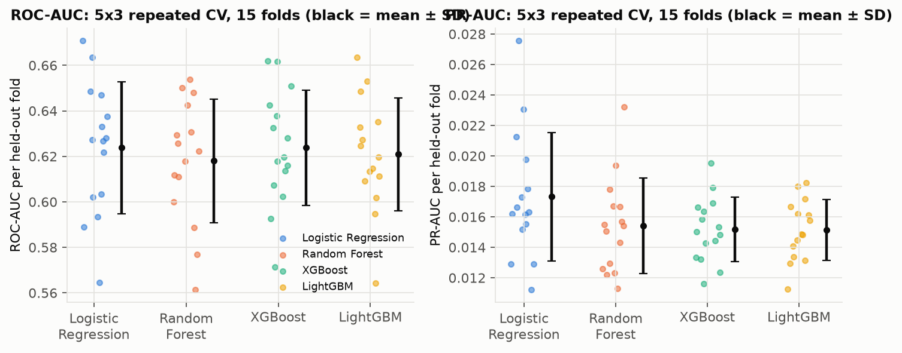

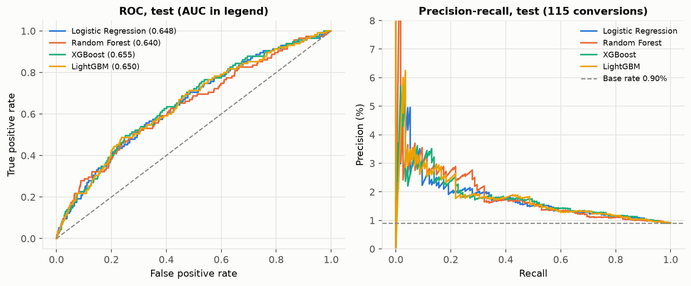

### Test performance: Visit (secondary)

Test base rate 14.67% (1878 positives out of 12,800). A random scorer has PR-AUC equal to the base rate.

| Model | ROC-AUC | PR-AUC | Brier | Log loss | Top-10% lift (x) |
|---|---|---|---|---|---|
| Logistic Regression | 0.654 [0.641, 0.667] | 0.2362 [0.2216, 0.2536] | 0.1205 [0.1164, 0.1246] | 0.3983 [0.3878, 0.4087] | 1.88 [1.73, 2.03] |
| Random Forest | 0.651 [0.638, 0.664] | 0.2341 [0.2195, 0.2502] | 0.1207 [0.1165, 0.1249] | 0.3987 [0.3881, 0.4091] | 1.89 [1.74, 2.03] |
| XGBoost * | 0.656 [0.643, 0.669] | 0.2369 [0.2218, 0.2538] | 0.1205 [0.1163, 0.1246] | 0.3983 [0.3877, 0.4087] | 1.84 [1.69, 2.00] |
| LightGBM | 0.656 [0.644, 0.669] | 0.2371 [0.2222, 0.2539] | 0.1205 [0.1162, 0.1246] | 0.3979 [0.3873, 0.4084] | 1.85 [1.70, 1.99] |

\* best on validation PR-AUC. Paired bootstrap, XGBoost minus Logistic Regression: ΔROC-AUC = 0.002 [-0.001, 0.004] (two-sided p = 0.196); ΔPR-AUC = 0.0007 [-0.0034, 0.0045] (p = 0.796).

Repeated stratified 5x3 CV on train+val (same tuned configs), mean ± SD over 15 folds:

| Model | ROC-AUC | PR-AUC |
|---|---|---|
| Logistic Regression | 0.645 ± 0.006 | 0.2284 ± 0.0069 |
| Random Forest | 0.641 ± 0.004 | 0.2258 ± 0.0061 |
| XGBoost | 0.646 ± 0.005 | 0.2298 ± 0.0065 |
| LightGBM | 0.646 ± 0.004 | 0.2296 ± 0.0064 |

### Class imbalance: reweighting does not improve ranking and wrecks probabilities

Same tuned hyperparameters, three treatments of the ~0.9% positive class, 5-fold CV on train (mean ± SD across folds). The last column is mean predicted probability divided by the true base rate: 1.0 means the average score is an honest probability.

| Model | Strategy | ROC-AUC | PR-AUC | Brier | ECE | Mean pred / base rate |
|---|---|---|---|---|---|---|
| Logistic Regression | No reweighting | 0.613 ± 0.030 | 0.0183 ± 0.0048 | 0.0090 ± 0.0001 | 0.0032 ± 0.0007 | 1.00 ± 0.01 |
| Logistic Regression | Class weight | 0.625 ± 0.029 | 0.0188 ± 0.0075 | 0.2330 ± 0.0026 | 0.4603 ± 0.0044 | 51.80 ± 0.81 |
| Logistic Regression | Undersample 10:1 | 0.610 ± 0.027 | 0.0181 ± 0.0047 | 0.0157 ± 0.0001 | 0.0814 ± 0.0003 | 9.98 ± 0.10 |
| Random Forest | No reweighting | 0.609 ± 0.032 | 0.0152 ± 0.0015 | 0.0090 ± 0.0001 | 0.0028 ± 0.0007 | 1.00 ± 0.01 |
| Random Forest | Class weight | 0.611 ± 0.034 | 0.0150 ± 0.0034 | 0.2210 ± 0.0024 | 0.4548 ± 0.0036 | 51.19 ± 0.72 |
| Random Forest | Undersample 10:1 | 0.607 ± 0.033 | 0.0174 ± 0.0081 | 0.0163 ± 0.0001 | 0.0814 ± 0.0007 | 9.98 ± 0.13 |
| XGBoost | No reweighting | 0.621 ± 0.026 | 0.0149 ± 0.0033 | 0.0090 ± 0.0001 | 0.0032 ± 0.0006 | 0.98 ± 0.02 |
| XGBoost | Class weight | 0.617 ± 0.025 | 0.0144 ± 0.0028 | 0.2156 ± 0.0022 | 0.4439 ± 0.0036 | 49.99 ± 0.74 |
| XGBoost | Undersample 10:1 | 0.614 ± 0.028 | 0.0141 ± 0.0019 | 0.0160 ± 0.0001 | 0.0794 ± 0.0007 | 9.77 ± 0.13 |
| LightGBM | No reweighting | 0.618 ± 0.029 | 0.0147 ± 0.0034 | 0.0090 ± 0.0001 | 0.0029 ± 0.0004 | 0.98 ± 0.01 |
| LightGBM | Class weight | 0.605 ± 0.029 | 0.0141 ± 0.0026 | 0.0927 ± 0.0460 | 0.2646 ± 0.1021 | 30.15 ± 11.17 |
| LightGBM | Undersample 10:1 | 0.609 ± 0.030 | 0.0142 ± 0.0026 | 0.0156 ± 0.0001 | 0.0794 ± 0.0006 | 9.76 ± 0.13 |

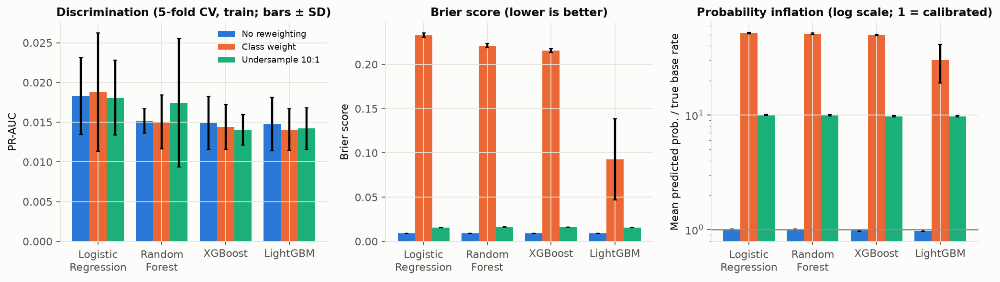

### Calibration (conversion, test)

Calibrators are fit on the validation predictions of models trained on train, then scored on test. ECE uses 10 equal-mass bins (about 1280 customers, ~12 conversions per bin), so it is noisy and biased upward for small samples (bootstrap ECE CIs can therefore sit above the point estimate). Brier differences between variants are far inside the CIs; ECE differences are not resolvable either.

| Model | Calibration | Brier | ECE | Mean pred (base rate 0.90%) |
|---|---|---|---|---|
| Logistic Regression | None | 0.00889 [0.00736, 0.01049] | 0.0026 [0.0019, 0.0045] | 0.91% |
| Logistic Regression | Platt | 0.00888 [0.00737, 0.01046] | 0.0011 [0.0013, 0.0034] | 0.89% |
| Logistic Regression | Isotonic | 0.00889 [0.00737, 0.01047] | 0.0013 [0.0013, 0.0035] | 0.89% |
| Random Forest | None | 0.00888 [0.00737, 0.01046] | 0.0024 [0.0018, 0.0046] | 0.91% |
| Random Forest | Platt | 0.00888 [0.00737, 0.01046] | 0.0024 [0.0018, 0.0046] | 0.89% |
| Random Forest | Isotonic | 0.00888 [0.00737, 0.01046] | 0.0028 [0.0017, 0.0041] | 0.89% |
| XGBoost | None | 0.00888 [0.00736, 0.01048] | 0.0019 [0.0017, 0.0040] | 0.89% |
| XGBoost | Platt | 0.00888 [0.00736, 0.01048] | 0.0020 [0.0017, 0.0041] | 0.89% |
| XGBoost | Isotonic | 0.00889 [0.00738, 0.01048] | 0.0019 [0.0017, 0.0039] | 0.90% |
| LightGBM | None | 0.00888 [0.00736, 0.01048] | 0.0023 [0.0018, 0.0043] | 0.89% |
| LightGBM | Platt | 0.00888 [0.00736, 0.01048] | 0.0024 [0.0018, 0.0044] | 0.89% |
| LightGBM | Isotonic | 0.00888 [0.00738, 0.01045] | 0.0018 [0.0015, 0.0035] | 0.90% |

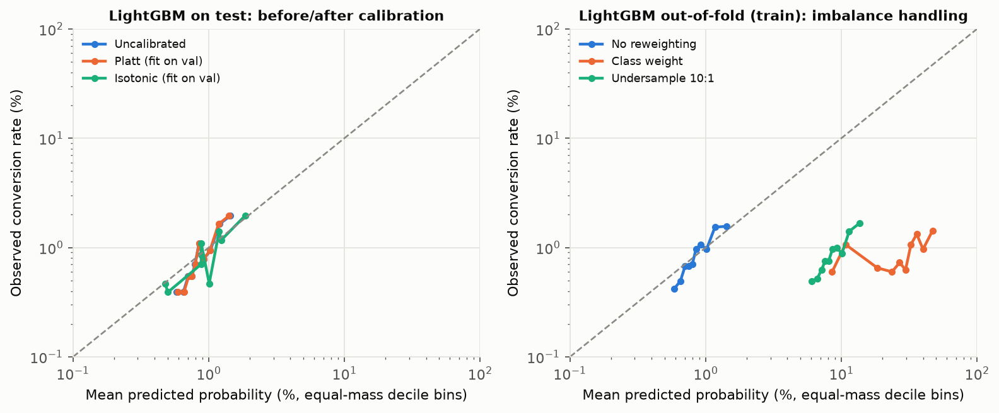

### Targeting: LightGBM, test

Decision rule (fixed before looking at test): contact customers whose score is >= the VAL 80th percentile of the best model's scores (top 20%); threshold = 0.0111. It flags 20.0% of test customers.

| | Converted | Did not convert |
|---|---|---|
| Flagged | 46 (TP) | 2,511 (FP) |
| Not flagged | 69 (FN) | 10,174 (TN) |

Recall 40.00% [30.91%, 49.02%]; precision 1.80% [1.29%, 2.31%] (base rate 0.90%).

| Decile | Conversion rate (95% CI) | Lift (95% CI) | Conversions | Cumulative share of conversions |
|---|---|---|---|---|
| 1 | 1.95% [1.25, 2.73] | 2.17 [1.39, 3.04] | 25 | 22% |
| 2 | 1.64% [1.02, 2.42] | 1.83 [1.13, 2.70] | 21 | 40% |
| 3 | 0.94% [0.39, 1.56] | 1.04 [0.43, 1.74] | 12 | 50% |
| 4 | 0.78% [0.31, 1.33] | 0.87 [0.35, 1.48] | 10 | 59% |
| 5 | 1.09% [0.55, 1.64] | 1.22 [0.61, 1.83] | 14 | 71% |
| 6 | 0.70% [0.31, 1.17] | 0.78 [0.35, 1.30] | 9 | 79% |
| 7 | 0.55% [0.16, 0.94] | 0.61 [0.17, 1.04] | 7 | 85% |
| 8 | 0.55% [0.23, 1.02] | 0.61 [0.26, 1.13] | 7 | 91% |
| 9 | 0.39% [0.08, 0.70] | 0.43 [0.09, 0.78] | 5 | 96% |
| 10 | 0.39% [0.08, 0.78] | 0.43 [0.09, 0.87] | 5 | 100% |

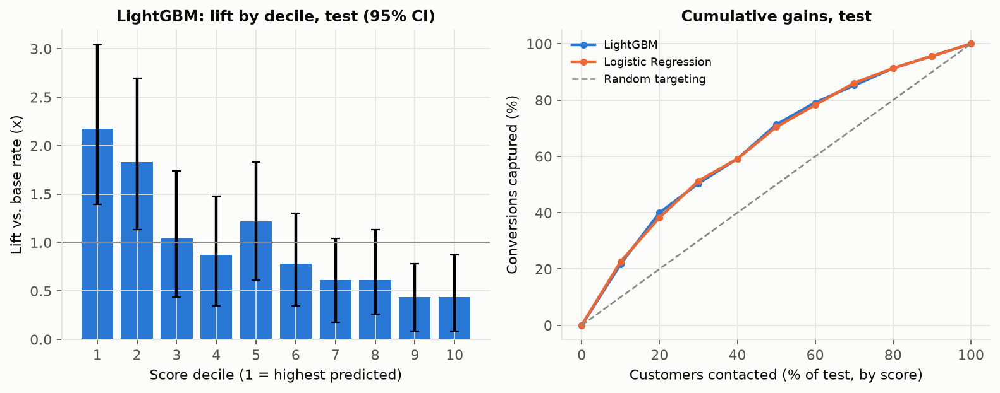

### Attribution (LightGBM, best tree model)

| Feature | Mean abs SHAP (log-odds) | Permutation importance, PR-AUC drop (mean ± SD) |
|---|---|---|
| Men's e-mail sent | 0.1177 | 0.00373 ± 0.00103 |
| history ($) | 0.0977 | 0.00078 ± 0.00257 |
| recency | 0.0839 | 0.00099 ± 0.00192 |
| new customer | 0.0332 | 0.00161 ± 0.00066 |
| log history | 0.0321 | -0.00082 ± 0.00229 |
| channel phone | 0.0310 | -0.00036 ± 0.00108 |
| zip rural | 0.0273 | 0.00014 ± 0.00032 |
| recent buyer | 0.0214 | 0.00003 ± 0.00096 |

Top-3 by SHAP: Men's e-mail sent, history ($), recency. Top-3 by permutation: Men's e-mail sent, new customer, recency (2/3 overlap). Spearman correlation of the two rankings across all 18 features: 0.53 (p = 0.024). SHAP used 6,000 validation rows; permutation importance used all 12,800 validation rows, which hold only ~115 conversions, so its SDs are large. Correlated features (history / log history / bucket, zip dummies, channel dummies) split credit, so single-feature rankings understate the importance of the underlying concept.

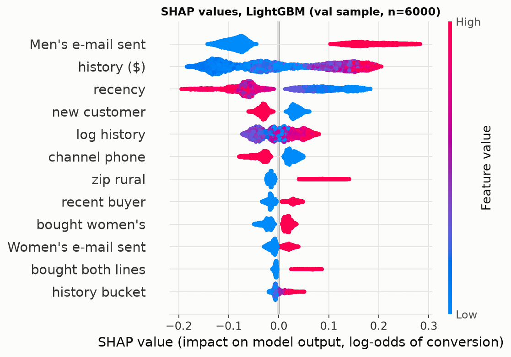

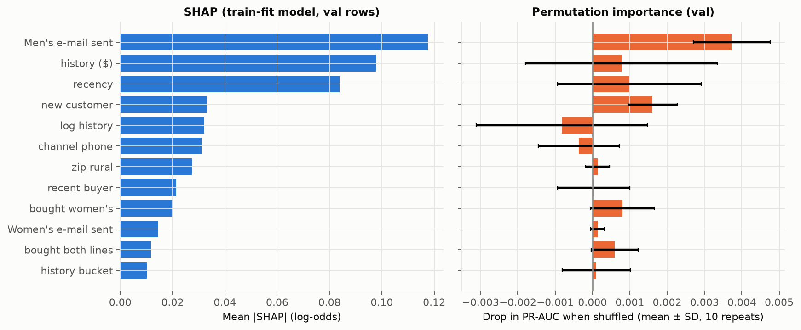

### Error analysis (conversion, test)

| Subgroup | n | Conversions | Observed rate (95% CI) | Mean predicted (95% CI) | ROC-AUC (95% CI; shown if >=10 conversions) |
|---|---|---|---|---|---|
| channel: Multichannel | 1,544 | 14 | 0.91% [0.45, 1.46] | 1.16% [1.14, 1.17] | 0.675 [0.561, 0.784] |
| channel: Phone | 5,571 | 46 | 0.83% [0.61, 1.06] | 0.82% [0.81, 0.83] | 0.664 [0.580, 0.748] |
| channel: Web | 5,685 | 55 | 0.97% [0.72, 1.25] | 0.89% [0.89, 0.90] | 0.639 [0.562, 0.716] |
| zip_code: Rural | 1,903 | 17 | 0.89% [0.47, 1.26] | 0.98% [0.97, 1.00] | 0.448 [0.314, 0.600] |
| zip_code: Suburban | 5,781 | 46 | 0.80% [0.57, 1.02] | 0.88% [0.87, 0.88] | 0.686 [0.616, 0.764] |
| zip_code: Urban | 5,116 | 52 | 1.02% [0.76, 1.27] | 0.88% [0.87, 0.88] | 0.668 [0.590, 0.751] |
| newbie: existing | 6,387 | 64 | 1.00% [0.76, 1.25] | 0.90% [0.89, 0.91] | 0.623 [0.546, 0.693] |
| newbie: newbie | 6,413 | 51 | 0.80% [0.60, 1.01] | 0.88% [0.88, 0.89] | 0.681 [0.604, 0.758] |
| history_bucket: 1 | 4,618 | 33 | 0.71% [0.48, 0.95] | 0.77% [0.76, 0.77] | 0.602 [0.505, 0.693] |
| history_bucket: 2 | 2,814 | 20 | 0.71% [0.43, 1.07] | 0.75% [0.74, 0.75] | 0.655 [0.557, 0.758] |
| history_bucket: 3 | 2,492 | 20 | 0.80% [0.44, 1.20] | 0.99% [0.98, 1.00] | 0.675 [0.534, 0.817] |
| history_bucket: 4 | 1,279 | 15 | 1.17% [0.55, 1.88] | 1.12% [1.10, 1.13] | 0.644 [0.494, 0.756] |
| history_bucket: 5 | 977 | 12 | 1.23% [0.61, 1.94] | 1.15% [1.13, 1.16] | 0.574 [0.424, 0.720] |
| history_bucket: 6 | 370 | 7 | 1.89% [0.81, 3.24] | 1.23% [1.20, 1.25] | n/a |
| history_bucket: 7 | 250 | 8 | 3.20% [1.20, 5.20] | 1.29% [1.26, 1.31] | n/a |
| arm: Mens E-Mail | 4,261 | 53 | 1.24% [0.95, 1.56] | 1.05% [1.05, 1.06] | 0.656 [0.581, 0.725] |
| arm: No E-Mail | 4,261 | 24 | 0.56% [0.36, 0.80] | 0.80% [0.79, 0.81] | 0.594 [0.474, 0.706] |
| arm: Womens E-Mail | 4,278 | 38 | 0.89% [0.64, 1.17] | 0.82% [0.82, 0.83] | 0.628 [0.538, 0.716] |

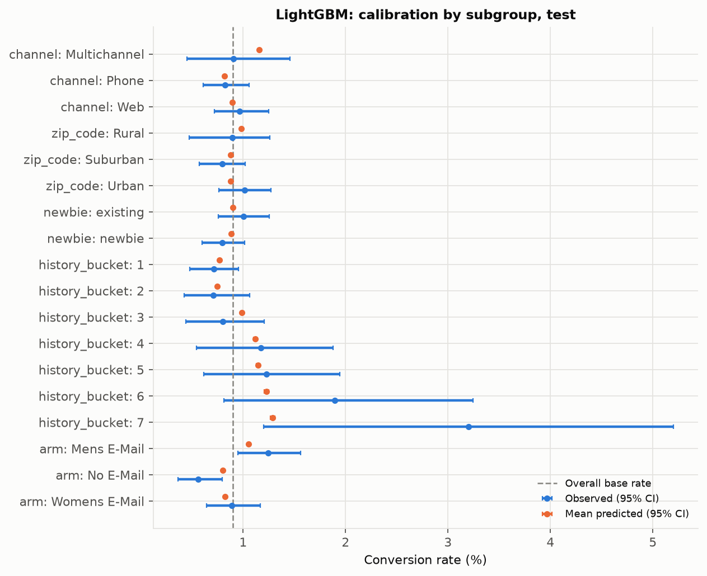

**Who the model misses.** At the top-20% rule, 69 of 115 test converters are not flagged. Mean features of caught vs missed converters (median spend: $94.10 caught vs $87.40 missed):

| Feature | Caught converters | Missed converters |
|---|---|---|
| recency | 2.804 | 5.841 |
| history ($) | 582.370 | 200.198 |
| new customer | 0.478 | 0.420 |
| recent buyer | 0.761 | 0.333 |
| zip urban | 0.500 | 0.420 |
| zip suburban | 0.457 | 0.362 |
| zip rural | 0.043 | 0.217 |
| channel phone | 0.304 | 0.464 |
| channel web | 0.413 | 0.522 |
| channel multi | 0.283 | 0.014 |
| bought men's | 0.696 | 0.464 |
| bought women's | 0.696 | 0.623 |
| Men's e-mail sent | 0.696 | 0.304 |
| Women's e-mail sent | 0.152 | 0.449 |
| No e-mail sent | 0.152 | 0.246 |

### Caveats

- Only 115 test conversions: every conversion CI above is wide, and most model-to-model differences are within noise. Visits (1878 positives) are much better powered.
- Model selection used validation PR-AUC on ~115 validation conversions, so the 'best' model is partly a coin flip among near-equals; the paired bootstrap on test is the honest comparison.
- Calibrators (especially isotonic) are fit on ~115 validation conversions and can overfit; test ECE/Brier show whether they helped.
- Scores mix baseline propensity and e-mail response. Exposure is a feature, so 'likely to convert' is not 'persuadable'; targeting by these scores is not causal targeting.
- 2 weeks of outcomes, one 2008 retailer, history floor-censored at $29.99 for 12.4% of customers; hyperparameter tuning saw only train folds, but the same test set is shared across pipeline stages by design (never used for selection here).
- SHAP explains the model, not the world: attribution to correlated features is arbitrary between them.

## Observational methods vs. an experimental ground truth

Marketing data are usually observational: marketers email the customers they already expect to buy, so a naive emailed-vs-not comparison is confounded. Because Hillstrom is randomized, we can manufacture that selection bias from real customers and real outcomes and check which estimators recover the experimental answer (a LaLonde-style design). A targeting rule e(X) (below) plays the marketer. From the RCT, emailed customers are kept with probability c*e(X)/p and un-emailed ones with c*(1-e(X))/(1-p), where p = 0.6671 is the RCT's emailed share and c = 0.394 is the largest value keeping both probabilities <= 1. Retention is then c for every X, so the observational sample has the full population's customer mix (the estimand is the population ATE) while its true propensity is exactly e(X); selection uses only (X, T), so there is no unmeasured confounding by construction. Ground truth is the RCT difference in means on all 64,000 customers. We analyse one observational sample in detail (n = 25,312), then repeat the whole pipeline on 300 simulated samples (each: bootstrap the 64,000 customers, then apply the targeting draw) and score each estimator's bias, RMSE and 95% CI coverage of the benchmark. Nuisance models are cross-fitted (5 folds): a main-effects logistic regression, which is misspecified here by design (the rule has a VIP interaction, a win-back arm that is non-monotone in recency, a $300 threshold and a bounded link), and LightGBM. Matching is 1:1 nearest-neighbour on the logit PS with replacement and a 0.2-SD caliper (Abadie-Imbens variance); it is run for the ATE and, separately, for the ATT, which is scored against the RCT's ATT for the observational population (the e(X)-weighted RCT difference in means).

**Targeting rule** (logit score, mapped to e = 0.1 + 0.8 * sigmoid(score))

| Term | Coefficient | Share of customers |
|---|---|---|
| Intercept | -1.8 |  |
| Recent buyer (recency <= 3 mo) | +1.6 | 35.0% |
| High value (history >= $300) | +1.2 | 27.8% |
| VIP: recent x high value | +1.6 | 13.5% |
| Win-back: lapsed (recency >= 10) x high value | +2.2 | 3.4% |
| Multichannel buyer | +1.0 | 12.1% |
| Bought both mens and womens | +1.0 | 10.1% |
| New customer (last 12 mo) | -0.8 | 50.2% |

True propensity ranges 0.155-0.892; the marketer emails 37.2% of customers. Observational samples average 25,273 customers (37.2% emailed).

**Ground truth from the RCT (all 64,000 customers)**

| Outcome | RCT ATE [95% CI] | Covariate-adjusted ATE (Lin) | ATT of observational population [95% CI] | ATT - ATE [95% CI] |
|---|---|---|---|---|
| Site visit (pp) | 6.09 [5.54, 6.63] | 6.07 | 6.49 [5.77, 7.21] | 0.40 [0.03, 0.78] |
| Conversion (pp) | 0.50 [0.35, 0.64] | 0.49 | 0.56 [0.36, 0.76] | 0.06 [-0.04, 0.16] |
| Spend ($) | 0.597 [0.376, 0.817] | 0.595 | 0.667 [0.368, 0.965] | 0.070 [-0.080, 0.220] |

### Propensity model diagnostics

Single sample (n = 25,312); bracketed ranges are the 2.5-97.5th percentiles across the 300 simulated samples.

| | True e(X) | Logistic PS | GBM PS |
|---|---|---|---|
| AUC (out-of-fold) | 0.768 [0.763, 0.775] | 0.755 [0.749, 0.761] | 0.765 [0.758, 0.771] |
| RMSE vs true propensity | - | 0.094 [0.094, 0.096] | 0.039 [0.041, 0.047] |
| Share of PS outside [0.05, 0.95] | 0.000 [0.000, 0.000] | 0.001 [0.000, 0.003] | 0.000 [0.000, 0.000] |
| Max abs SMD after IPW, model features | 0.021 [0.017, 0.049] | 0.113 [0.044, 0.124] | 0.018 [0.009, 0.022] |
| Max abs SMD after IPW, incl. rule terms | 0.021 [0.020, 0.051] | 0.202 [0.176, 0.212] | 0.018 [0.009, 0.022] |
| Effective sample size, emailed | 6,686 [6,582, 6,833] | 6,255 [6,063, 6,531] | 6,540 [6,315, 6,743] |
| Effective sample size, not emailed | 11,164 [11,008, 11,510] | 10,304 [9,147, 12,191] | 11,158 [10,316, 11,162] |
| Calibration slope [95% CI] | - | 0.99 [0.96, 1.03] | 0.98 [0.95, 1.01] |
| Expected calibration error / Brier | - | 0.028 / 0.1853 | 0.009 / 0.1777 |

Before weighting the max |SMD| is 0.710 on model features and 0.792 including the rule terms (simulation range 0.782-0.834). Logistic-PS weighting leaves the rule's interaction terms imbalanced (max |SMD| 0.202, above the 0.1 threshold) while GBM-PS weighting balances everything (0.018). No trimming was needed: the true propensity is bounded in [0.1, 0.9] by design and estimated scores are only clipped to [0.01, 0.99] as a numerical guard (no units dropped, estimand unchanged). The matching caliper dropped at most 0.14% of units (97.5th percentile over runs).

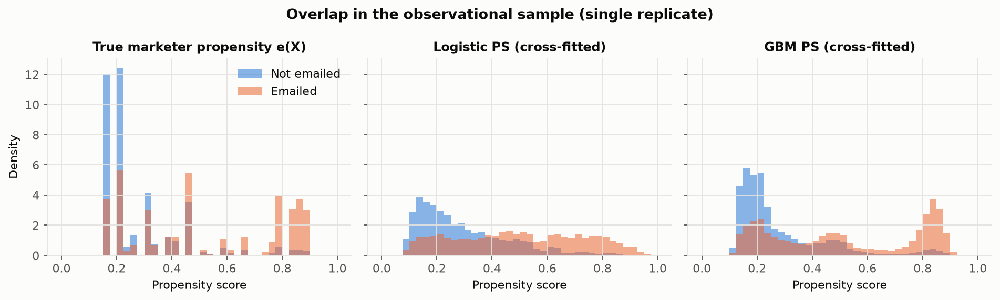

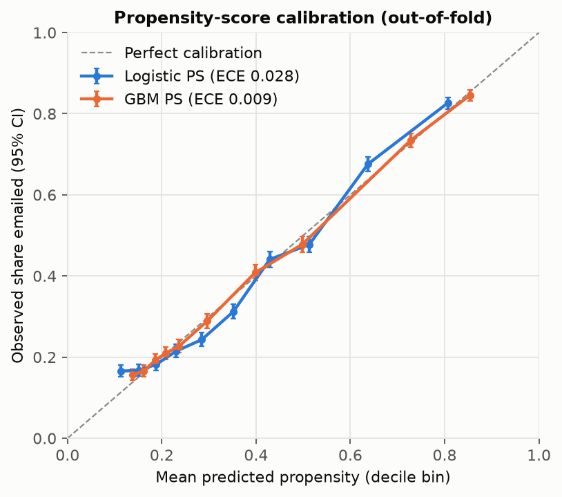

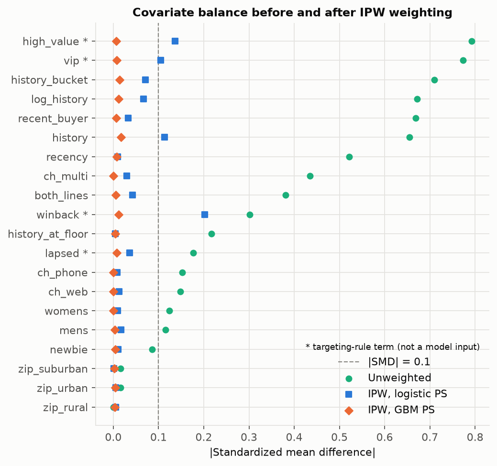

### Simulation results: site visit (300 observational samples)

Benchmark: RCT ATE 6.09 pp for ATE rows; RCT ATT 6.49 pp for ATT rows. Bias CIs are Monte Carlo 95% CIs; RMSE and SE-ratio CIs bootstrap the replicates; coverage CIs are Wilson. Bias/SD is bias in units of the estimator's sampling SD; the 10x-n column projects coverage if the sample were ten times larger and the bias did not shrink (honest SEs assumed). SE ratio = mean reported SE / empirical SD (1 = honest).

| Estimator | Estimand | Bias, pp [95% CI] (% of truth) | Bias/SD | RMSE, pp [95% CI] | Coverage [95% CI] | Coverage at 10x n | SE ratio [95% CI] |
|---|---|---|---|---|---|---|---|
| Naive difference in means | ATE | 3.738 [3.690, 3.786] (+61.4%) | +8.80 | 3.762 [3.715, 3.809] | 0.000 [0.000, 0.013] | 0.00 | 1.10 [1.03, 1.19] |
| OLS adjustment (Y ~ T + X) | ATE | 0.095 [0.039, 0.152] (+1.6%) | +0.19 | 0.510 [0.470, 0.551] | 0.950 [0.919, 0.969] | 0.91 | 1.01 [0.94, 1.10] |
| PS stratification, quintiles (logistic) | ATE | 0.315 [0.260, 0.371] (+5.2%) | +0.65 | 0.581 [0.537, 0.628] | 0.927 [0.891, 0.951] | 0.47 | 1.05 [0.97, 1.14] |
| PS stratification, quintiles (GBM) | ATE | 0.317 [0.260, 0.374] (+5.2%) | +0.63 | 0.593 [0.549, 0.638] | 0.913 [0.876, 0.940] | 0.49 | 1.04 [0.96, 1.12] |
| PS matching 1:1, caliper (logistic) | ATE | 0.093 [0.025, 0.161] (+1.5%) | +0.15 | 0.608 [0.558, 0.657] | 0.957 [0.927, 0.975] | 0.92 | 1.10 [1.01, 1.19] |
| PS matching 1:1, caliper (GBM) | ATE | 0.178 [0.107, 0.249] (+2.9%) | +0.28 | 0.651 [0.600, 0.698] | 0.953 [0.923, 0.972] | 0.85 | 1.07 [0.99, 1.16] |
| IPW, Hajek (logistic) | ATE | -0.150 [-0.209, -0.090] (-2.5%) | -0.29 | 0.542 [0.501, 0.585] | 0.943 [0.911, 0.964] | 0.85 | 1.05 [0.97, 1.14] |
| IPW, Hajek (GBM) | ATE | -0.062 [-0.119, -0.004] (-1.0%) | -0.12 | 0.512 [0.475, 0.549] | 0.967 [0.940, 0.982] | 0.93 | 1.07 [0.99, 1.15] |
| AIPW (logistic PS + GLM outcome) | ATE | 0.049 [-0.008, 0.107] (+0.8%) | +0.10 | 0.508 [0.468, 0.548] | 0.967 [0.940, 0.982] | 0.94 | 1.09 [1.01, 1.18] |
| AIPW (GBM PS + GBM outcome) | ATE | -0.036 [-0.094, 0.023] (-0.6%) | -0.07 | 0.515 [0.476, 0.553] | 0.967 [0.940, 0.982] | 0.94 | 1.06 [0.99, 1.15] |
| AIPW (logistic PS + GBM outcome) | ATE | -0.016 [-0.075, 0.043] (-0.3%) | -0.03 | 0.518 [0.478, 0.559] | 0.963 [0.936, 0.979] | 0.95 | 1.06 [0.99, 1.15] |
| AIPW (GBM PS + GLM outcome) | ATE | -0.024 [-0.082, 0.033] (-0.4%) | -0.05 | 0.508 [0.470, 0.544] | 0.970 [0.944, 0.984] | 0.95 | 1.07 [1.00, 1.15] |
| IPW, Hajek (true PS, oracle) | ATE | 0.005 [-0.053, 0.063] (+0.1%) | +0.01 | 0.513 [0.474, 0.551] | 0.953 [0.923, 0.972] | 0.95 | 1.04 [0.97, 1.13] |
| PS matching 1:1, caliper (logistic) | ATT | -0.005 [-0.097, 0.088] (-0.1%) | -0.01 | 0.815 [0.746, 0.886] | 0.953 [0.923, 0.972] | 0.95 | 1.08 [0.99, 1.18] |
| PS matching 1:1, caliper (GBM) | ATT | 0.266 [0.171, 0.362] (+4.1%) | +0.32 | 0.885 [0.816, 0.951] | 0.950 [0.919, 0.969] | 0.83 | 1.08 [1.00, 1.17] |

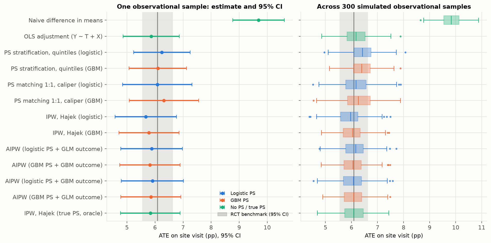

### Conversion and spend

| Estimator | Estimand | Conversion bias % [95% CI] | Conversion RMSE (pp) | Conversion coverage | Spend bias % [95% CI] | Spend RMSE ($) | Spend coverage |
|---|---|---|---|---|---|---|---|
| Naive difference in means | ATE | +65.7% [+62.5, +68.8] | 0.353 | 0.280 | +54.0% [+50.0, +57.9] | 0.384 | 0.687 |
| OLS adjustment (Y ~ T + X) | ATE | -10.1% [-13.3, -6.8] | 0.152 | 0.927 | -14.5% [-18.4, -10.6] | 0.223 | 0.943 |
| PS stratification, quintiles (logistic) | ATE | -6.0% [-9.3, -2.7] | 0.149 | 0.940 | -7.8% [-11.8, -3.8] | 0.215 | 0.947 |
| PS stratification, quintiles (GBM) | ATE | +7.1% [+3.8, +10.3] | 0.145 | 0.940 | +6.2% [+2.2, +10.2] | 0.214 | 0.957 |
| PS matching 1:1, caliper (logistic) | ATE | -6.7% [-10.6, -2.7] | 0.177 | 0.953 | -6.8% [-11.5, -2.2] | 0.248 | 0.950 |
| PS matching 1:1, caliper (GBM) | ATE | +3.0% [-0.8, +6.8] | 0.167 | 0.947 | +4.4% [-0.7, +9.6] | 0.273 | 0.970 |
| IPW, Hajek (logistic) | ATE | -9.5% [-13.1, -5.9] | 0.164 | 0.950 | -11.4% [-15.4, -7.3] | 0.223 | 0.960 |
| IPW, Hajek (GBM) | ATE | -0.4% [-3.8, +3.0] | 0.148 | 0.943 | +0.1% [-4.0, +4.1] | 0.213 | 0.960 |
| AIPW (logistic PS + GLM outcome) | ATE | -1.8% [-5.5, +1.9] | 0.160 | 0.973 | -10.4% [-14.2, -6.5] | 0.213 | 0.963 |
| AIPW (GBM PS + GBM outcome) | ATE | +0.6% [-2.9, +4.0] | 0.151 | 0.957 | +1.8% [-2.3, +5.9] | 0.216 | 0.967 |
| AIPW (logistic PS + GBM outcome) | ATE | -2.0% [-5.5, +1.5] | 0.152 | 0.960 | -1.7% [-5.6, +2.3] | 0.208 | 0.967 |
| AIPW (GBM PS + GLM outcome) | ATE | +0.4% [-3.0, +3.8] | 0.149 | 0.943 | +0.6% [-3.4, +4.6] | 0.212 | 0.963 |
| IPW, Hajek (true PS, oracle) | ATE | +0.7% [-2.7, +4.1] | 0.147 | 0.927 | +1.4% [-2.5, +5.4] | 0.207 | 0.960 |
| PS matching 1:1, caliper (logistic) | ATT | -9.5% [-14.1, -4.8] | 0.235 | 0.963 | -9.0% [-14.6, -3.3] | 0.337 | 0.967 |
| PS matching 1:1, caliper (GBM) | ATT | +6.7% [+2.1, +11.2] | 0.228 | 0.937 | +4.8% [-1.1, +10.7] | 0.349 | 0.937 |

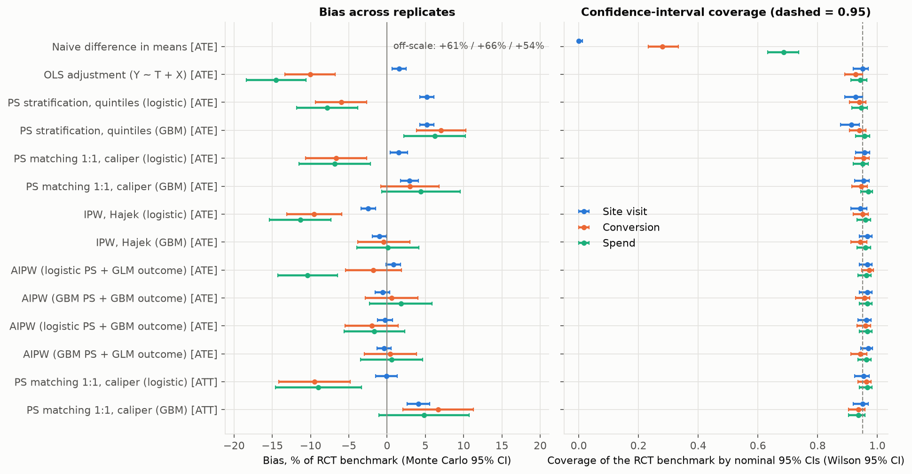

### Does double robustness rescue a misspecified propensity model?

Bias as % of the RCT benchmark [Monte Carlo 95% CI].

| Estimator | Site visit | Conversion | Spend |
|---|---|---|---|
| IPW, Hajek (logistic) | -2.5% [-3.4, -1.5] | -9.5% [-13.1, -5.9] | -11.4% [-15.4, -7.3] |
| PS stratification, quintiles (logistic) | +5.2% [+4.3, +6.1] | -6.0% [-9.3, -2.7] | -7.8% [-11.8, -3.8] |
| PS matching 1:1, caliper (logistic) | +1.5% [+0.4, +2.7] | -6.7% [-10.6, -2.7] | -6.8% [-11.5, -2.2] |
| AIPW (logistic PS + GLM outcome) | +0.8% [-0.1, +1.8] | -1.8% [-5.5, +1.9] | -10.4% [-14.2, -6.5] |
| AIPW (logistic PS + GBM outcome) | -0.3% [-1.2, +0.7] | -2.0% [-5.5, +1.5] | -1.7% [-5.6, +2.3] |
| IPW, Hajek (GBM) | -1.0% [-2.0, -0.1] | -0.4% [-3.8, +3.0] | +0.1% [-4.0, +4.1] |
| AIPW (GBM PS + GBM outcome) | -0.6% [-1.5, +0.4] | +0.6% [-2.9, +4.0] | +1.8% [-2.3, +5.9] |

### Findings

- **Naive comparison is badly confounded.** In the single sample the naive visit lift is 9.69 pp [8.77, 10.61] vs the RCT's 6.09 pp [5.54, 6.63]; across samples its bias is +61.4% [+60.6, +62.2] of the true effect and its CI covers the truth 0.0% of the time. For spend it is +54.0% [+50.0, +57.9].
- **Best estimator (visit; lowest RMSE among those with no detectable bias and nominal coverage): AIPW (GBM PS + GLM outcome)** - bias -0.4% [-1.3, +0.5], RMSE 0.508 pp [0.470, 0.544], coverage 0.970 [0.944, 0.984]. It is also the lowest-RMSE estimator overall. Paired RMSE ratio vs the next estimator by RMSE (AIPW (logistic PS + GLM outcome)): 0.999 [0.957, 1.044], i.e. statistically indistinguishable, so the ranking within the top group is not robust. Estimators passing both checks: AIPW (GBM PS + GLM outcome) [ATE], AIPW (logistic PS + GLM outcome) [ATE], AIPW (GBM PS + GBM outcome) [ATE], AIPW (logistic PS + GBM outcome) [ATE], PS matching 1:1, caliper (logistic) [ATT].
- **Significant under-coverage (visit; Wilson upper bound < 0.95):** Naive difference in means [ATE], PS stratification, quintiles (GBM) [ATE].
- **No detectable bias on any of the three outcomes:** AIPW (GBM PS + GBM outcome) [ATE], AIPW (logistic PS + GBM outcome) [ATE], AIPW (GBM PS + GLM outcome) [ATE].
- **What the misspecified logistic PS costs.** Estimators relying on it alone (IPW, stratification, ATE and ATT matching) are significantly biased in 11 of 12 estimator-outcome cells (IPW: visit -2.5%, conversion -9.5%, spend -11.4%), but at n ~ 25,273 the bias is only 0.29 SD for visit, so CIs still cover at about the nominal rate (0.943). The danger grows with scale: with 10x the customers the same bias would cut visit coverage to about 0.85. IPW with the GBM PS shrinks the bias but does not remove it (visit -1.0% [-2.0, -0.1]): plug-in IPW with an ML propensity keeps some regularization bias, which AIPW's outcome-model correction cancels.
- **Double robustness rescues the misspecified PS when the outcome model is flexible.** AIPW keeping the logistic PS but adding a GBM outcome model has bias -0.3% [-1.2, +0.7] (visit), -2.0% [-5.5, +1.5] (conversion), -1.7% [-5.6, +2.3] (spend). With a GLM outcome model instead (both nuisances parametric) there is no detectable bias for site visit and conversion, but it remains for spend (-10.4% [-14.2, -6.5]): with both nuisance models misspecified, double robustness carries no guarantee.
- **Stratification leaves residual confounding regardless of the PS model** (visit bias +5.2% [+4.3, +6.1] logistic, +5.2% [+4.3, +6.1] GBM): five strata are too coarse for a propensity spanning 0.16-0.89.
- **Conversion (about 1% base rate):** RCT ATE 0.495 pp [0.355, 0.636]; naive bias +65.7% [+62.5, +68.8], coverage 0.280; best by the same rule: IPW, Hajek (GBM) (bias -0.4% [-3.8, +3.0], RMSE 0.148 pp, coverage 0.943). Even the best estimator's per-sample RMSE is 30% of the effect, so single observational conversion estimates are imprecise.

**Caveats**

- Semi-synthetic by design: the selection mechanism is known and depends only on observed X, so unconfoundedness holds exactly. Real targeting also uses signals the analyst never sees (e.g. browsing), which no estimator here can fix; this study isolates *modelling* error, not hidden confounding.
- The simulation's truth is the full-sample RCT estimate (bootstrap world; the oracle IPW's bias of +0.1% [-0.9, +1.0] confirms the benchmark is the right target). The RCT's own sampling error (visit CI half-width 0.54 pp) is not in the bias/coverage numbers; the covariate-adjusted RCT estimate differs from the difference in means by -0.017 pp.
- Bootstrap duplicates make ML nuisances slightly noisier than in a fresh sample of the same size (GBM PS RMSE vs truth: 0.039 in the real single sample vs 0.041-0.047 across replicates), so the simulation is if anything conservative for GBM-based estimators.
- Results are conditional on one targeting rule. Hillstrom outcomes are close to additive in these features, so the interactions the logistic PS omits carry little outcome signal; a rule keyed to outcome-relevant nonlinearities would make misspecification costlier.
- Standard errors treat the estimated PS as known: conservative for ATE IPW/matching with a parametric PS, no guarantee for the GBM PS or ATT matching. OLS with a treatment dummy targets a variance-weighted average of effects, which equals the ATE only if effects are homogeneous.
- 'Emailed' pools two creatives (Mens/Womens, 50/50 at every X), identically in the RCT and the observational samples. GBM hyperparameters were fixed up front, not tuned on the benchmark.
- Monte Carlo precision: 300 replicates pin coverage to about +/-2.5 pp; conversion is the least precise outcome. SE ratios share one set of replicates, so they drift together: the naive estimator's Welch SE (exact in theory) shows a ratio of 1.10 here but 1.002 [0.978, 1.027] over 3,000 cheap replicates with no model fitting, so SE ratios a few percent above 1 are Monte Carlo noise, not miscalibration.

## Uplift modeling and budget optimization: who should get the email, and which one?

**Method.** Five CATE learners for any email vs none — S-, T- and X-learners with LightGBM bases (early-stopped on validation), econml's DR-learner and CausalForestDML (3-fold cross-fitting) — are fit on the 38,400-customer train split and compared with a classic response model that ranks customers by P(visit | X, emailed). The propensity is supplied, not learned: assignment was randomized, so econml receives a prior-only classifier that returns each fold's assignment share (≈ 2/3 any email, 1/3 per arm); a covariate propensity model could only add noise. The learner used for targeting is chosen by validation-set normalized Qini (12,800 customers); the 12,800-customer test split is used once, with 2,000 paired bootstrap draws for CIs and refits over seeds 0, 1, 2, 3, 4 for model-randomness spread. Budgeted policies are scored off-policy with inverse-propensity weighting using the known 1/3 arm probabilities.

**Headline (test set, 95% CIs):**

- Val-selected learner **DR-learner**: normalized Qini 0.033 [0.006, 0.062] (5-seed 0.028 ± 0.003) vs response model 0.031 [0.002, 0.059]; AUUC gain 4.44 [0.98, 8.08] vs 4.09 [0.51, 7.67] extra visits / 1k. The margin over response targeting, 0.35 [-3.20, 3.74] visits / 1k, is **not statistically significant** (95% CI includes 0).
- BLP heterogeneity test: β2 = 0.62 [0.14, 1.11], one-sided p = 0.006 — the CATE ranking carries real heterogeneity.
- Top segment "bought women's AND past-year spend > \$364": visit uplift 10.6 [6.8, 14.4] pp; bottom segment "men's-only buyer AND not bought in last 3 months AND past-year spend ≤ \$255": 4.2 [2.0, 6.3] pp (equal-effects p = 0.003).
- **20% budget, per 1,000 customers.** Response policy: 19.2 [10.5, 28.4] visits, 2.11 [-0.47, 4.69] conversions, \$207 [-256, 690] revenue. Binary-uplift policy: 15.5 [7.0, 23.4] visits, 1.41 [-0.70, 3.52] conversions, \$175 [-211, 569]. Uplift vs response: -20 [-54, 31]% visits, -33 [-200, 200]% conversions, -16 [-503, 644]% revenue (CI includes 0 for visits). Multi-arm uplift vs response: -37 [-73, 7]% visits (CI includes 0).
- **30% budget, per 1,000 customers.** Response policy: 31.4 [21.1, 41.7] visits, 3.52 [0.47, 6.33] conversions, \$513 [-48, 1122] revenue. Binary-uplift policy: 22.7 [13.4, 31.9] visits, 1.64 [-0.70, 3.98] conversions, \$186 [-211, 588]. Uplift vs response: -28 [-52, 3]% visits, -53 [-150, 20]% conversions, -64 [-207, 145]% revenue (CI includes 0 for visits). Multi-arm uplift vs response: -27 [-54, 2]% visits (CI includes 0).

**Bottom line.** Emailing the top 30% ranked by the response model captures 41 [30, 52]% of the incremental visits of emailing everyone, using 30% of the sends (random targeting captures 30% by construction). Uplift models find real heterogeneity ("bought women's AND past-year spend > \$364": 10.6 [6.8, 14.4] pp vs 6.1 pp on average) but do not rank customers better than the simpler response model at a 30% budget (-8.7 [-18.3, 0.7] visits / 1k), so the extra modeling does not pay for itself in targeting on this campaign. For email choice, the multi-arm model agrees with the rule "Womens email to women's-only buyers, Mens otherwise" for 77% of customers and does not beat it (-0.5 [-8.9, 8.0] visits / 1k).

### 1. Ranking quality: CATE learners vs a response model

Outcome = visit, treatment = any email. Normalized Qini = area between the model's Qini curve and random, divided by the same area for a perfect ranking (0 = random). AUUC gain = average over targeting depths of extra incremental visits per 1,000 customers vs random targeting. BLP β2 is the Chernozhukov et al. test of whether the score carries real effect heterogeneity (β2 > 0; β2 = 1 = well calibrated). `*` = selected on validation.

| Learner | Val norm. Qini | Test norm. Qini [95% CI] | 5-seed mean ± sd | AUUC gain / 1k [95% CI] | Δ AUUC gain vs response [95% CI] | BLP β2 [95% CI] | β2 one-sided p |
|---|---|---|---|---|---|---|---|
| S-learner | 0.018 | 0.044 [0.016, 0.074] | 0.044 ± 0.006 | 5.72 [2.07, 9.52] | 1.63 [-1.19, 4.45] | 0.93 [0.33, 1.53] | 0.001 |
| T-learner | 0.016 | 0.027 [-0.001, 0.057] | 0.032 ± 0.004 | 3.58 [0.05, 7.37] | -0.51 [-4.32, 3.36] | 0.51 [0.01, 1.02] | 0.023 |
| X-learner | 0.018 | 0.037 [0.011, 0.066] | 0.040 ± 0.003 | 4.88 [1.53, 8.53] | 0.79 [-3.03, 4.46] | 1.24 [0.35, 2.13] | 0.003 |
| DR-learner * | 0.019 | 0.033 [0.006, 0.062] | 0.028 ± 0.003 | 4.44 [0.98, 8.08] | 0.35 [-3.20, 3.74] | 0.62 [0.14, 1.11] | 0.006 |
| Causal forest | 0.015 | 0.035 [0.008, 0.065] | 0.033 ± 0.003 | 4.57 [1.11, 8.36] | 0.48 [-3.23, 4.24] | 0.74 [0.18, 1.30] | 0.005 |
| Response model | 0.002 | 0.031 [0.002, 0.059] | 0.033 ± 0.001 | 4.09 [0.51, 7.67] | — | 0.23 [-0.01, 0.48] | 0.030 |

- **Heterogeneity is real for visits:** 5/5 CATE learners have BLP β2 > 0 at one-sided p < 0.05 on the held-out test set.
- **But uplift ranking does not beat response ranking:** no CATE learner's AUUC gain is significantly above the response model's (every paired 95% CI includes 0). The response model's own normalized Qini is 0.031 [0.002, 0.059] and its BLP β2 p = 0.030: customers most likely to visit when emailed are also, on average, the ones the email moves most.
- Validation-set Qini barely separates the learners (range 0.015–0.019); the val-selected learner is **DR-learner**, while the post-hoc test-best is S-learner (0.044). Headline numbers use the val-selected learner.

Conversion and spend (same learners, same protocol):

| Learner | Conversion norm. Qini [95% CI] | Conversion BLP β2 p | Spend norm. Qini [95% CI] | Spend BLP β2 p |
|---|---|---|---|---|
| S-learner | -0.066 [-0.181, 0.043] | 0.874 | 0.070 [-0.069, 0.202] | 0.488 |
| T-learner | -0.064 [-0.187, 0.068] | 0.767 | -0.146 [-0.281, -0.007] | 0.835 |
| X-learner | -0.059 [-0.181, 0.062] | 0.888 | 0.114 [-0.045, 0.277] | 0.135 |
| DR-learner | -0.037 [-0.152, 0.081] | 0.807 | -0.059 [-0.212, 0.095] | 0.734 |
| Causal forest | -0.071 [-0.190, 0.046] | 0.908 | -0.070 [-0.211, 0.075] | 0.858 |
| Response model | 0.046 [-0.076, 0.167] | 0.236 | -0.002 [-0.142, 0.135] | 0.473 |

For conversion 0/5 and for spend 0/5 learners show significant heterogeneity. With 24 control-group conversions in the test set, conversion and spend CATEs are not reliable and are not used for targeting claims.

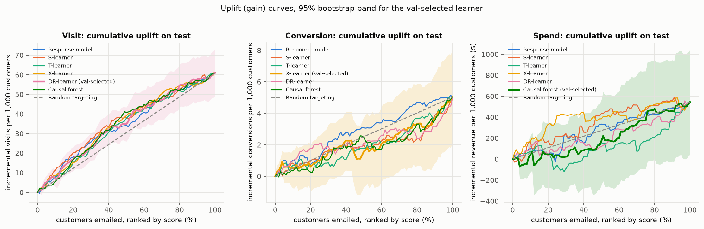

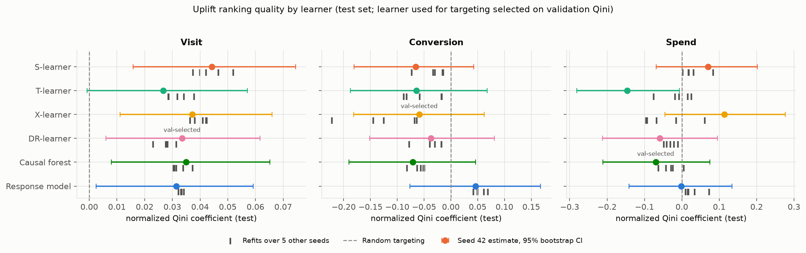

### 2. Is the heterogeneity real? GATES and BLP

Test-set ATE of any email on visits: 6.09 [4.88, 7.31] pp. Ranking test customers by the DR-learner CATE, BLP β2 = 0.62 [0.14, 1.11] (one-sided p = 0.006; across 5 refit seeds β2 = 0.54 ± 0.05). Group average treatment effects (observed treated − control within each predicted quintile; valid because assignment is randomized inside every group):

| Quintile (1 = highest score) | Ranked by DR-learner: uplift pp [95% CI] | Ranked by response model: uplift pp [95% CI] |
|---|---|---|
| 1 | 8.4 [5.4, 11.4] | 8.9 [5.7, 12.2] |
| 2 | 8.0 [5.4, 10.6] | 7.1 [4.1, 10.0] |
| 3 | 5.3 [2.5, 8.1] | 4.9 [2.1, 7.6] |
| 4 | 6.0 [3.4, 8.6] | 6.1 [3.7, 8.5] |
| 5 | 3.2 [0.8, 5.7] | 4.0 [2.1, 5.8] |
| Top − bottom | 5.1 [1.3, 9.0] (p = 0.010) | 5.0 [1.2, 8.7] (p = 0.010) |

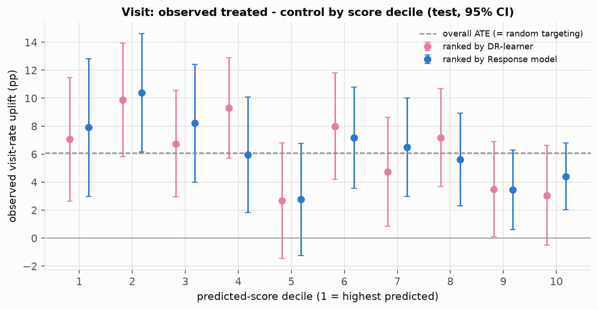

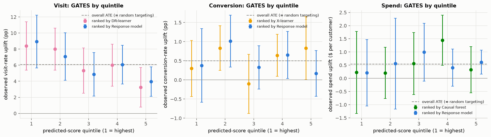

### 3. Who responds? Interpretable segments

Causal-forest heterogeneity importance (visit), grouped over redundant encodings: Product line (mens, womens, both) 48%, Past spend (history, log, bucket, floor) 32%, Recency (recency, recent_buyer) 9%.

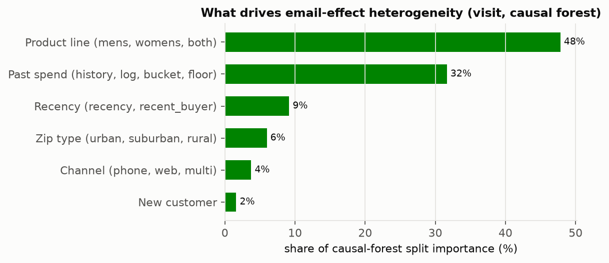

A depth-3 `SingleTreeCateInterpreter` tree was fit to the forest's CATEs on the **validation** set (min 1,000 customers per leaf); each leaf rule is then scored on the **test** set:

| Segment rule | Share | Forest CATE (pp) | Observed visit uplift, pp [95% CI] | Observed spend uplift, \$ [95% CI] |
|---|---|---|---|---|
| bought women's AND past-year spend > \$364 | 14% | 8.2 | 10.6 [6.8, 14.4] | 2.20 [0.46, 3.95] |
| bought women's AND \$38 < past-year spend ≤ \$364 | 34% | 7.4 | 8.1 [6.0, 10.1] | 0.52 [-0.30, 1.35] |
| bought women's AND past-year spend ≤ \$38 | 8% | 6.5 | 5.5 [1.4, 9.7] | 0.57 [-0.79, 1.94] |
| men's-only buyer AND past-year spend > \$255 | 12% | 5.5 | 1.9 [-1.9, 5.6] | -0.24 [-2.21, 1.72] |
| men's-only buyer AND bought in last 3 months AND past-year spend ≤ \$255 | 9% | 5.0 | 3.6 [-0.6, 7.9] | 1.42 [-0.20, 3.04] |
| men's-only buyer AND not bought in last 3 months AND past-year spend ≤ \$255 | 23% | 3.6 | 4.2 [2.0, 6.3] | -0.31 [-1.17, 0.56] |

Equal-effects test across segments (Cochran's Q): visit Q = 18.3, df = 5, p = 0.003; spend p = 0.120; conversion p = 0.280. Highest- minus lowest-predicted segment: 6.4 [2.1, 10.8] pp.

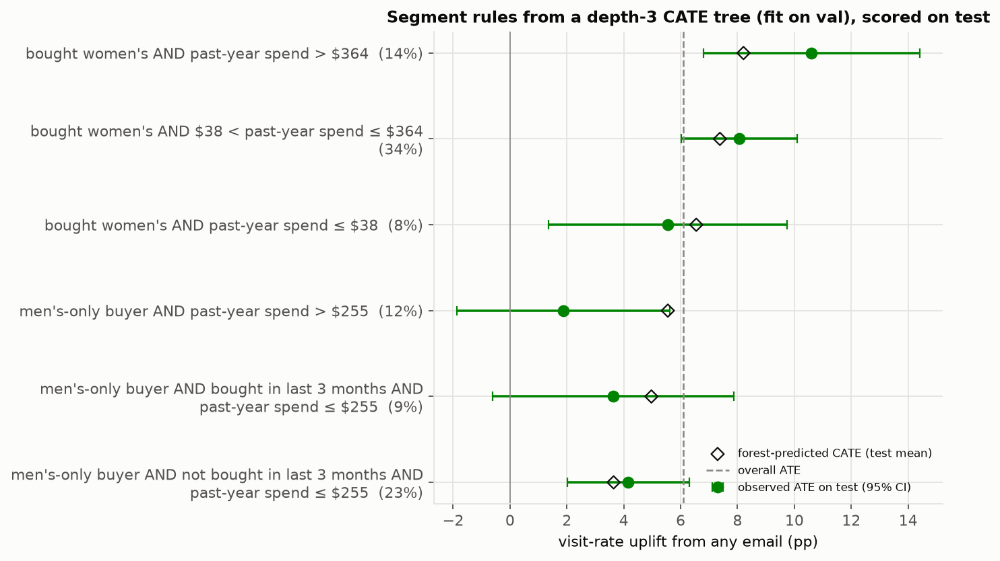

**Behavioral clusters.** KMeans on standardized recency, log_history, mens, womens, newbie, ch_web, ch_phone (fit on train); k = 5 maximizes the train silhouette (k=3: 0.239, k=4: 0.290, k=5: 0.320, k=6: 0.301, k=7: 0.301, k=8: 0.303).

| Cluster | Profile | Share (train) | Recency (mo) | Past spend (\$) | Visit uplift, pp [95% CI] | Spend uplift, \$ [95% CI] |
|---|---|---|---|---|---|---|
| C4 | multichannel, new, recent, high spend | 16% | 3.6 | 612 | 8.8 [5.5, 12.1] | 1.92 [0.25, 3.58] |
| C2 | women's only, web | 20% | 6.1 | 162 | 7.9 [5.1, 10.6] | 0.71 [-0.09, 1.52] |
| C0 | women's only, phone | 22% | 6.3 | 177 | 6.2 [3.8, 8.7] | 0.84 [0.26, 1.42] |
| C3 | men's only, phone | 20% | 6.0 | 160 | 4.5 [2.0, 7.0] | 0.22 [-0.95, 1.38] |
| C1 | men's only, web | 22% | 6.3 | 174 | 3.9 [1.2, 6.5] | -0.63 [-2.07, 0.81] |

Equal-effects test across clusters: visit p = 0.079 (Q = 8.4, df = 4), spend p = 0.184. Unsupervised clusters separate the email effect less sharply than the CATE-tree segments.

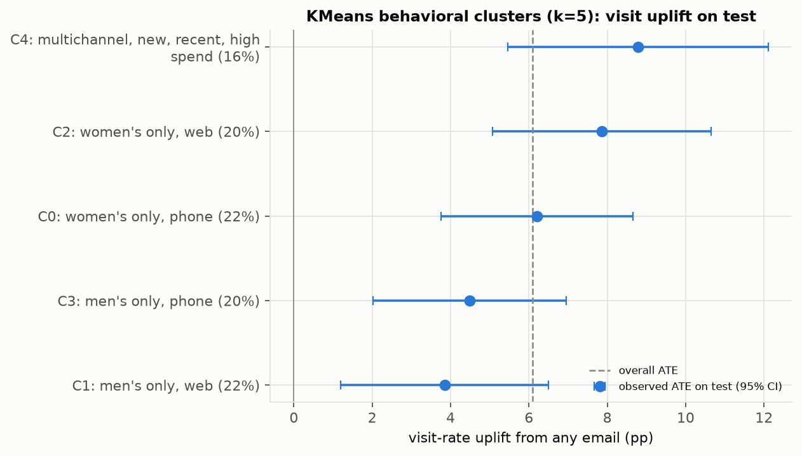

### 4. Which email? Multi-arm CATE

One causal forest over the 3-level arm gives per-customer CATEs for Mens vs none and Womens vs none (test means: 7.6 pp and 4.7 pp; BLP β2 one-sided p = 0.039 and <0.001). 76% of test customers are predicted to respond more to the Mens email and 24% to the Womens email (Womens share over 5 refit seeds: 23% ± 1.3%).

| Past purchases | Test customers | Predicted to prefer Womens email | Mean CATE Mens (pp) | Mean CATE Womens (pp) |
|---|---|---|---|---|
| Men's only | 5,634 | 0% | 6.9 | 1.4 |
| Women's only | 5,905 | 51% | 7.6 | 7.5 |
| Both lines | 1,261 | 7% | 10.7 | 5.9 |

The model's email choice agrees with a one-line rule ("Womens email to women's-only buyers, Mens otherwise") for 77% of customers. Randomized check among emailed test customers: sending the model's pick instead of the other email raises visits by 4.0 [2.4, 5.6] pp; the purchase rule achieves 4.2 [2.6, 5.8] pp. Emailing everyone (IPW, incremental outcomes per 1,000 customers vs no email):

| Policy (100% emailed) | Visits / 1k [95% CI] | Conversions / 1k [95% CI] | Revenue \$ / 1k [95% CI] |
|---|---|---|---|
| Everyone gets Mens | 76.4 [60.5, 92.3] | 6.80 [3.05, 11.02] | 805 [154, 1508] |
| Everyone gets Womens | 45.9 [30.7, 60.9] | 3.28 [-0.23, 6.80] | 288 [-265, 855] |
| Purchase-line rule | 80.9 [64.4, 96.8] | 6.80 [3.05, 10.78] | 780 [137, 1434] |
| Model's higher-CATE email | 80.4 [64.0, 96.6] | 6.80 [3.05, 10.55] | 841 [183, 1510] |

Model vs all-Mens: 4.0 [-4.5, 12.4] visits / 1k (p = 0.383); model vs purchase rule: -0.5 [-8.9, 8.0] (p = 0.938). The model’s advantage over the one-line rule is **not statistically significant** (95% CI includes 0).

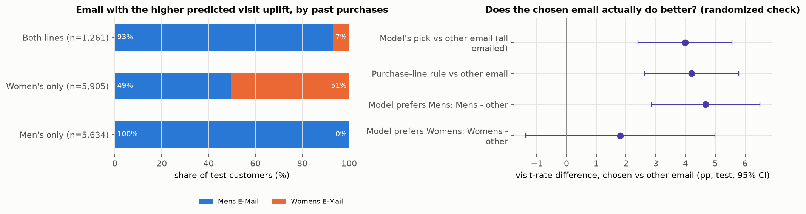

### 5. Budget allocation: incremental outcomes under a fixed contact budget

Each policy emails a fixed share of test customers; policies that are not arm-aware send the email with the best average visit rate on train (Mens E-Mail). Values are Horvitz–Thompson IPW estimates on test, V(π) − V(no email) = mean[Y·(1{A=π(X)} − 1{A=0}) / (1/3)], unbiased because each arm had known probability 1/3. iROAS = incremental revenue / (contacts × \$0.10); the cost per email is an illustrative assumption, so break-even cost per contact is reported too. 95% bootstrap CIs (paired draws).

| Budget | Policy | Visits / 1k | Conversions / 1k | Revenue \$ / 1k | iROAS | Break-even \$ / contact |
|---|---|---|---|---|---|---|
| 10% | Random targeting | 7.6 [6.0, 9.2] | 0.68 [0.30, 1.10] | 80 [15, 151] | 8.0 [1.5, 15.1] | 0.80 [0.15, 1.51] |
| 10% | Response model (visit propensity if emailed), send Mens | 8.7 [1.6, 15.5] | 1.88 [-0.23, 3.98] | 140 [-206, 502] | 14.0 [-20.6, 50.2] | 1.40 [-2.06, 5.02] |
| 10% | Binary uplift (any-email CATE), send Mens | 4.5 [-1.6, 10.3] | 0.47 [-0.94, 2.11] | 57 [-270, 397] | 5.7 [-27.0, 39.7] | 0.57 [-2.70, 3.97] |
| 10% | Mens-email uplift (CATE Mens vs none), send Mens | 7.7 [1.4, 14.1] | 1.88 [0.00, 3.75] | 286 [-114, 726] | 28.6 [-11.4, 72.6] | 2.86 [-1.14, 7.26] |
| 10% | Multi-arm uplift, send higher-CATE email | 6.3 [0.0, 12.4] | 2.11 [0.47, 3.98] | 302 [-88, 735] | 30.2 [-8.8, 73.5] | 3.02 [-0.88, 7.35] |
| 10% | Revenue uplift (multi-arm CATE on spend), send higher-CATE email | 4.2 [-0.9, 9.4] | -0.94 [-2.34, 0.23] | -120 [-397, 124] | -12.0 [-39.7, 12.4] | -1.20 [-3.97, 1.24] |
| 10% | Response model (expected spend if emailed), send Mens | 3.0 [-1.9, 8.4] | 0.00 [-1.17, 1.17] | 125 [-113, 425] | 12.5 [-11.3, 42.5] | 1.25 [-1.13, 4.25] |
| 20% | Random targeting | 15.3 [12.1, 18.5] | 1.36 [0.61, 2.20] | 161 [31, 302] | 8.0 [1.5, 15.1] | 0.80 [0.15, 1.51] |
| 20% | Response model (visit propensity if emailed), send Mens | 19.2 [10.5, 28.4] | 2.11 [-0.47, 4.69] | 207 [-256, 690] | 10.4 [-12.8, 34.5] | 1.04 [-1.28, 3.45] |
| 20% | Binary uplift (any-email CATE), send Mens | 15.5 [7.0, 23.4] | 1.41 [-0.70, 3.52] | 175 [-211, 569] | 8.7 [-10.5, 28.5] | 0.87 [-1.05, 2.85] |
| 20% | Mens-email uplift (CATE Mens vs none), send Mens | 14.3 [6.1, 22.7] | 1.64 [-0.70, 3.98] | 238 [-179, 692] | 11.9 [-8.9, 34.6] | 1.19 [-0.89, 3.46] |
| 20% | Multi-arm uplift, send higher-CATE email | 12.2 [4.2, 20.4] | 1.88 [-0.23, 4.22] | 276 [-140, 722] | 13.8 [-7.0, 36.1] | 1.38 [-0.70, 3.61] |
| 20% | Revenue uplift (multi-arm CATE on spend), send higher-CATE email | 13.6 [6.3, 20.9] | 0.23 [-1.88, 2.34] | -111 [-474, 206] | -5.5 [-23.7, 10.3] | -0.55 [-2.37, 1.03] |
| 20% | Response model (expected spend if emailed), send Mens | 11.0 [3.3, 18.5] | 0.00 [-2.11, 1.88] | 101 [-230, 454] | 5.1 [-11.5, 22.7] | 0.51 [-1.15, 2.27] |
| 30% | Random targeting | 22.9 [18.1, 27.7] | 2.04 [0.91, 3.30] | 241 [46, 453] | 8.0 [1.5, 15.1] | 0.80 [0.15, 1.51] |
| 30% | Response model (visit propensity if emailed), send Mens | 31.4 [21.1, 41.7] | 3.52 [0.47, 6.33] | 513 [-48, 1122] | 17.1 [-1.6, 37.4] | 1.71 [-0.16, 3.74] |
| 30% | Binary uplift (any-email CATE), send Mens | 22.7 [13.4, 31.9] | 1.64 [-0.70, 3.98] | 186 [-211, 588] | 6.2 [-7.0, 19.6] | 0.62 [-0.70, 1.96] |
| 30% | Mens-email uplift (CATE Mens vs none), send Mens | 17.8 [8.0, 27.2] | 2.11 [-0.47, 4.69] | 195 [-279, 698] | 6.5 [-9.3, 23.3] | 0.65 [-0.93, 2.33] |
| 30% | Multi-arm uplift, send higher-CATE email | 23.0 [13.1, 32.8] | 1.88 [-0.47, 4.45] | 282 [-136, 741] | 9.4 [-4.5, 24.7] | 0.94 [-0.45, 2.47] |
| 30% | Revenue uplift (multi-arm CATE on spend), send higher-CATE email | 22.3 [12.9, 31.2] | 1.64 [-0.94, 3.98] | 127 [-301, 557] | 4.2 [-10.0, 18.6] | 0.42 [-1.00, 1.86] |
| 30% | Response model (expected spend if emailed), send Mens | 19.0 [9.6, 28.6] | 1.64 [-0.94, 4.22] | 374 [-124, 892] | 12.5 [-4.1, 29.7] | 1.25 [-0.41, 2.97] |
| 50% | Random targeting | 38.2 [30.2, 46.2] | 3.40 [1.52, 5.51] | 402 [77, 754] | 8.0 [1.5, 15.1] | 0.80 [0.15, 1.51] |
| 50% | Response model (visit propensity if emailed), send Mens | 42.2 [29.1, 55.1] | 5.39 [2.11, 8.91] | 698 [111, 1337] | 14.0 [2.2, 26.7] | 1.40 [0.22, 2.67] |
| 50% | Binary uplift (any-email CATE), send Mens | 34.9 [23.4, 46.4] | 3.05 [0.23, 6.09] | 308 [-119, 728] | 6.2 [-2.4, 14.6] | 0.62 [-0.24, 1.46] |
| 50% | Mens-email uplift (CATE Mens vs none), send Mens | 41.5 [29.8, 53.2] | 4.22 [1.17, 7.50] | 549 [-25, 1171] | 11.0 [-0.5, 23.4] | 1.10 [-0.05, 2.34] |
| 50% | Multi-arm uplift, send higher-CATE email | 43.8 [31.9, 55.5] | 3.75 [0.70, 6.80] | 520 [-62, 1139] | 10.4 [-1.2, 22.8] | 1.04 [-0.12, 2.28] |
| 50% | Revenue uplift (multi-arm CATE on spend), send higher-CATE email | 33.0 [21.3, 45.2] | 2.81 [-0.23, 5.86] | 210 [-317, 739] | 4.2 [-6.3, 14.8] | 0.42 [-0.63, 1.48] |
| 50% | Response model (expected spend if emailed), send Mens | 35.2 [23.4, 47.3] | 3.75 [0.70, 7.03] | 542 [-47, 1183] | 10.8 [-0.9, 23.7] | 1.08 [-0.09, 2.37] |

Paired differences vs the response-model policy (uplift − response, same bootstrap draws; the last column is the mean ± sd of the visit difference over 5 refit seeds):

| Budget | Uplift policy | Δ visits / 1k [95% CI] | % change in visits [95% CI] | Δ conversions / 1k [95% CI] | Δ revenue \$ / 1k [95% CI] | Seeds: Δ visits / 1k |
|---|---|---|---|---|---|---|
| 10% | Binary uplift (any-email CATE), send Mens | -4.2 [-10.8, 2.6] | -49 [-138, 65] | -1.41 [-3.52, 0.70] | -83 [-306, 140] | -3.1 ± 1.4 |
| 10% | Mens-email uplift (CATE Mens vs none), send Mens | -0.9 [-7.3, 5.9] | -11 [-82, 200] | 0.00 [-1.88, 1.88] | 146 [-93, 469] | -0.7 ± 2.1 |
| 10% | Multi-arm uplift, send higher-CATE email | -2.3 [-9.1, 4.5] | -27 [-106, 136] | 0.23 [-1.88, 2.34] | 162 [-131, 532] | -2.6 ± 1.8 |
| 20% | Binary uplift (any-email CATE), send Mens | -3.8 [-11.7, 4.2] | -20 [-54, 31] | -0.70 [-2.81, 1.41] | -33 [-419, 317] | -4.1 ± 2.2 |
| 20% | Mens-email uplift (CATE Mens vs none), send Mens | -4.9 [-12.4, 3.1] | -26 [-60, 22] | -0.47 [-2.58, 1.41] | 31 [-390, 420] | -5.4 ± 1.3 |
| 20% | Multi-arm uplift, send higher-CATE email | -7.0 [-15.2, 0.9] | -37 [-73, 7] | -0.23 [-2.58, 2.11] | 68 [-369, 508] | -6.6 ± 1.5 |
| 30% | Binary uplift (any-email CATE), send Mens | -8.7 [-18.3, 0.7] | -28 [-52, 3] | -1.88 [-4.22, 0.47] | -328 [-839, 136] | -7.4 ± 1.9 |
| 30% | Mens-email uplift (CATE Mens vs none), send Mens | -13.6 [-22.7, -4.5] | -43 [-70, -16] | -1.41 [-3.52, 0.70] | -318 [-719, 35] | -9.0 ± 3.0 |
| 30% | Multi-arm uplift, send higher-CATE email | -8.4 [-18.3, 0.7] | -27 [-54, 2] | -1.64 [-3.98, 0.94] | -232 [-708, 217] | -8.2 ± 2.3 |
| 50% | Binary uplift (any-email CATE), send Mens | -7.3 [-16.4, 1.6] | -17 [-36, 5] | -2.34 [-4.45, -0.47] | -391 [-896, 40] | -6.4 ± 1.5 |
| 50% | Mens-email uplift (CATE Mens vs none), send Mens | -0.7 [-10.1, 8.0] | -2 [-21, 23] | -1.17 [-3.75, 1.17] | -149 [-414, 96] | -1.7 ± 1.2 |
| 50% | Multi-arm uplift, send higher-CATE email | 1.6 [-9.1, 12.2] | 4 [-19, 36] | -1.64 [-4.22, 1.17] | -179 [-491, 126] | -2.5 ± 2.8 |

**No uplift policy significantly beats response targeting on visits at any budget.** Response targeting is significantly better (CI excludes 0) for: Mens-email uplift (CATE Mens vs none), send Mens at 30%. Revenue-optimized policy (multi-arm causal forest on spend) vs a spend response model, Δ revenue \$ / 1k: 10%: -245 [-601, 23]; 20%: -212 [-628, 133]; 30%: -246 [-684, 158]; 50%: -332 [-767, 50]. Spend CATEs carry no detectable signal (Section 1), so that policy is tabulated but not recommended.

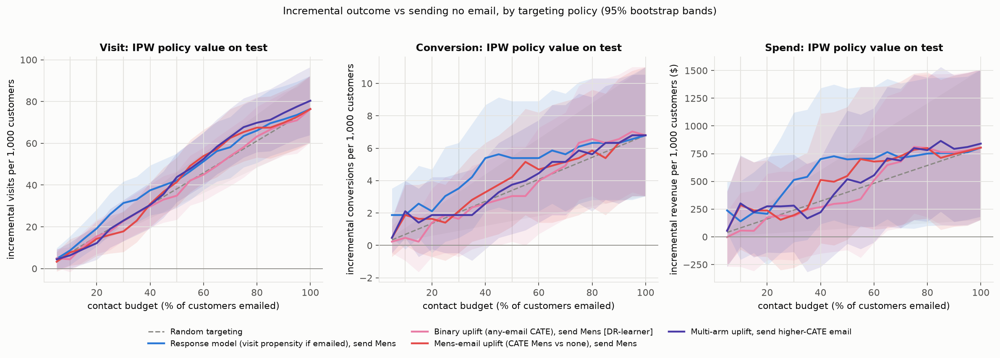

**Caveats**

- Conversion is rare (test control conversion rate 0.56%, ≈24 control conversions) and spend is zero for ≈99% of emailed customers; their CATE, Qini and revenue CIs are wide and mostly span 0. Only visit supports heterogeneity claims.
- The pooled any-email CATE averages two different emails; ranking by it and then sending the Mens email is an estimand/action mismatch (its top customers skew to women's-only buyers). The Mens-email uplift policy was added after diagnosing this, so it is a post-hoc comparison, not a pre-specified one.
- Learner selection on validation is noisy (val normalized Qini spans 0.015–0.019); test CIs overlap for all learners.
- One fixed train/val/test split. Chernozhukov et al. recommend repeating BLP/GATES over many splits and taking medians; seed refits here vary model randomness only, not the split.
- The Horvitz–Thompson IPW estimator is unbiased but high-variance, and many policy × budget × outcome comparisons are reported; treat any single nominally significant cell outside the pre-specified visit comparison with caution.
- Cost per email (\$0.10) is illustrative; iROAS scales inversely with it, break-even cost does not depend on it. Data are one 2008 two-week campaign; effects may not transfer to other creatives, seasons or lists.

## Difference-in-Differences on a geo experiment (GeoLift example panel)

**Method.** The customer-level Hillstrom data has no pre/post panel, so DiD uses Meta's GeoLift example panel: 40 US cities x 105 days (2021-01-01 to 2021-04-15), Y = daily conversions. Per the [GeoLift walkthrough](https://raw.githubusercontent.com/facebookincubator/GeoLift/main/vignettes/GeoLift_Walkthrough.Rmd), Chicago and Portland ran a $65,000, 15-day campaign (time stamps 91-105, 2021-04-01 to 2021-04-15); the other 38 cities are controls. The panel is balanced with no missing values. I estimate a 2x2 DiD, TWFE (location + date fixed effects), a ratio ("% lift") DiD, a synthetic control (non-negative weights summing to 1, fit on the 90 pre-days), and DiD against the 10 controls most correlated with the treated pair in the pre-period. **Inference is an exact randomization test**: "treatment" is reassigned to each of the 703 = C(38,2) pairs of control cities over the same window (re-fitting weights/matches for every pair), giving permutation p-values and test-inversion CIs. Estimates in the headline use the ratio DiD because city sizes differ ~5x (2.3k to 13.6k conversions/day), so a level-scale placebo distribution is dominated by big-city noise.

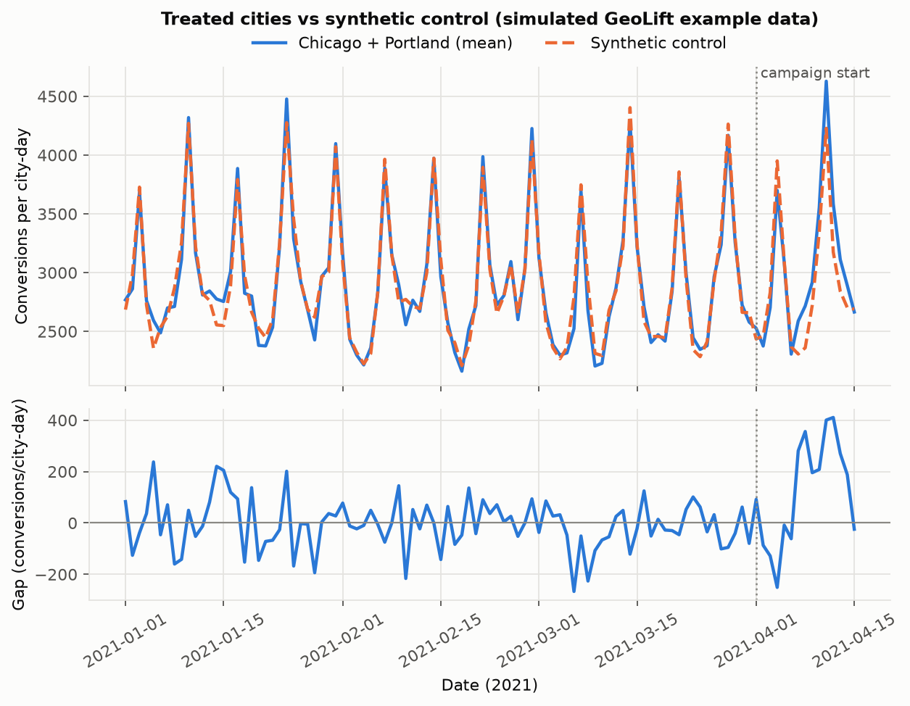

### Headline

| Quantity | Estimate | 95% CI |
|---|---|---|
| DiD % lift | 7.2% | [-6.5, 25.5]% |
| DiD ATT (conversions per city-day) | 203.3 | [-208.5, 615.2] |
| Permutation p-value (two-sided) | 0.352 (min. attainable 0.0014) | |
| Pre-trend test, permutation p | 0.727 | Wald F p: 2.2e-14 (cluster, degenerate), 0.082 (HC1) |
| Incremental conversions, 15 days | 6,098 | [-6,255, 18,456] |
| Cost per incremental conversion | $10.66 | [$3.52, unbounded] |
| In-time placebo p (same pair, 76 pre-period windows) | 0.013 | observed 6.6 log pts; largest placebo window 5.5 |
| MDE at 80% power (this design) | 10.2% | |

### All estimators vs GeoLift's published result

| Method | ATT / city-day | 95% CI | % lift | 95% CI | Incremental (15 d) | p (kind) |
|---|---|---|---|---|---|---|
| 2x2 DiD, levels | 255.1 | [-357.4, 867.5] | 9.2% | n/a | 7,652 | 0.411 (permutation (703 placebo pairs)) |
| Ratio DiD, % lift (primary) | 203.3 | [-208.5, 615.2] | 7.2% | [-6.5, 25.5]% | 6,098 | 0.352 (permutation (703 placebo pairs)) |
| TWFE, levels | 255.1 | [-267.2, 777.3] | 9.2% | n/a | 7,652 | 0.338 (cluster-robust (2 treated clusters; unreliable)) |
| TWFE, log Y | n/a | n/a | 10.4% | [-7.2, 31.3]% | n/a | 0.263 (cluster-robust (unreliable)) |
| Synthetic control | 122.7 | [-261.9, 507.3] | 4.2% | [-8.0, 20.2]% | 3,682 | 0.480 (permutation (703 placebo pairs)) |
| DiD, top-10 correlated controls | 249.8 | [-152.5, 652.0] | 9.0% | [-4.8, 27.5]% | 7,494 | 0.217 (permutation (703 placebo pairs)) |
| GeoLift published (benchmark) | 155.6 | n/a | 5.4% | n/a | 4,667 | 0.010 (GeoLift conformal/permutation, as published) |

Cell means per city-day: treated 2917 pre / 3024 post; controls 4489 pre / 4341 post. Level-DiD CIs are wide because the level placebo distribution mixes cities of very different size. GeoLift's numbers are the vignette's rounded prose values (it gives no CI in text; it uses augmented synthetic control with fixed effects). The cross-city permutation test (which uses only untreated cities' noise) is much more conservative than GeoLift's published p = 0.01, which is based on the treated pair's own fitted series; the in-time placebo above is the closer analogue, but it only measures the pair's own day-to-day volatility (overlapping windows, so p is approximate) and ignores drift relative to the control pool. Cost per incremental conversion implied by GeoLift's 4,667: $13.93.

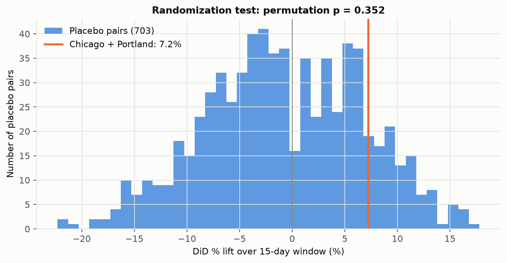

### Parallel trends

Weekly event study on log conversions (reference = week -1). Joint test that the 11 pre-period lead coefficients are zero: permutation p = 0.727; Wald F(11, 4043) p = 2.2e-14 with cluster-robust SEs (degenerate: the clustered covariance rests on 2 treated clusters and should be ignored) and 0.082 with HC1 SEs. RMS lead coefficient: 3.16 log points. A non-rejection is weak evidence for parallel trends when power is limited, and the parametric tests are unreliable with 2 treated units, so the placebo band is the fairer yardstick.

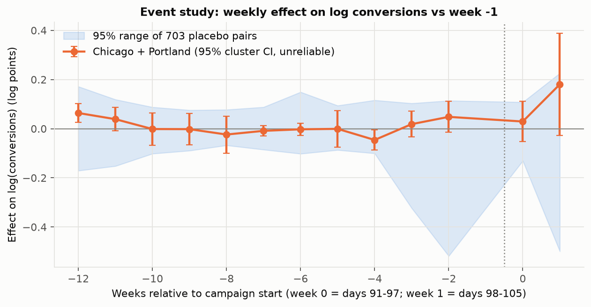

### Synthetic control

Pre-period RMSPE 97.7 conversions/city-day (3.35% of the treated mean); post-period gap 122.7 per city-day; post/pre RMSPE ratio 2.4 (placebo-rank p = 0.325). Largest donor weights: miami 0.21, cincinnati 0.21, baton rouge 0.16, dallas 0.11, honolulu 0.09.

### Power and minimum detectable effect

Using the untreated GeoLift_PreTest panel, I inject a multiplicative lift into 2 random pseudo-treated cities over a random 15-day window (pre-period = all earlier days, at least 45; effect grid 0-15%), and run the full ratio-DiD + 703-pair permutation test (500 simulations per effect size). Size at 0% lift: 5.0% (nominal 5%). **MDE at 80% power: 10.2%.**

| Injected lift | Power | 95% Wilson CI |
|---|---|---|
| 0% | 0.05 | [0.03, 0.07] |
| 1% | 0.05 | [0.03, 0.07] |
| 2% | 0.09 | [0.07, 0.12] |
| 3% | 0.14 | [0.11, 0.17] |
| 4% | 0.22 | [0.19, 0.26] |
| 5% | 0.33 | [0.29, 0.37] |
| 6% | 0.43 | [0.39, 0.48] |
| 7% | 0.53 | [0.49, 0.57] |
| 8% | 0.63 | [0.58, 0.67] |
| 9% | 0.71 | [0.67, 0.75] |
| 10% | 0.79 | [0.75, 0.82] |
| 11% | 0.84 | [0.80, 0.87] |
| 12% | 0.88 | [0.85, 0.91] |
| 13% | 0.90 | [0.87, 0.93] |
| 14% | 0.92 | [0.90, 0.94] |
| 15% | 0.94 | [0.92, 0.96] |

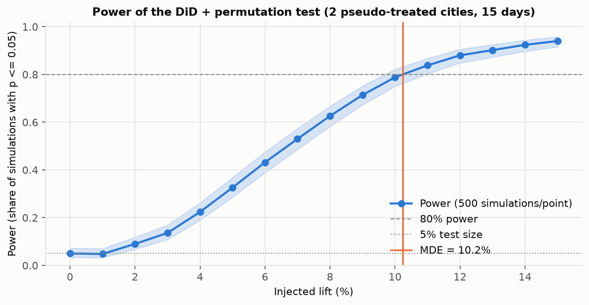

### Caveats

- **The panel is simulated example data published by Meta** ("simulated data of 40 US cities" per the GeoLift vignette), not a real advertiser's campaign. Treat all numbers as a methods demonstration.
- Only 2 treated cities: cluster-robust SEs (TWFE, event study Wald) are unreliable and are shown for completeness; the permutation test is the primary inference. With 703 placebo pairs the smallest attainable p-value is 0.0014.
- Treated cities were chosen by GeoLift's market-selection algorithm for fit, not randomized; the randomization test assumes exchangeability of city pairs, which selection on pre-period fit only approximately satisfies.
- Level DiD assumes additive parallel trends across cities of very different size; the ratio/log versions assume proportional trends and are preferred here.
- Test-inversion CIs assume a constant multiplicative effect over the window. Budget-based cost per conversion uses the vignette's stated $65,000 and ignores any baseline spend.
- The GeoLift benchmark is the rounded value quoted in the vignette prose, not a re-run of the R package; differences reflect method (fixed-effects augmented SCM vs. plain DiD/SCM).
- Power results are for this design on this panel (pre-period 45-75 days, 2 cities, 15 days) and use the same permutation test, with 500 simulations per effect size (Wilson CIs shown).

## Limitations

- The Hillstrom campaign is from 2008 and has only 8 raw pre-treatment attributes, so the HTE models have little to work with. That limits how much uplift targeting can gain over simpler rules.
- Conversions are rare (~0.9%), so conversion-level heterogeneity estimates are noisy. Visits carry most of the statistical signal.
- Campaign cost is not in the data. iROAS uses an illustrative cost per email (`config.COST_PER_CONTACT`), and the break-even cost per email is reported so no conclusion depends on it.
- The observational study is semi-synthetic: real customers and outcomes, but a selection mechanism we designed. It shows the estimators work when unconfoundedness holds; it cannot show that unconfoundedness holds in the wild.
